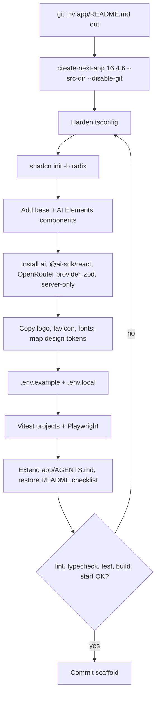
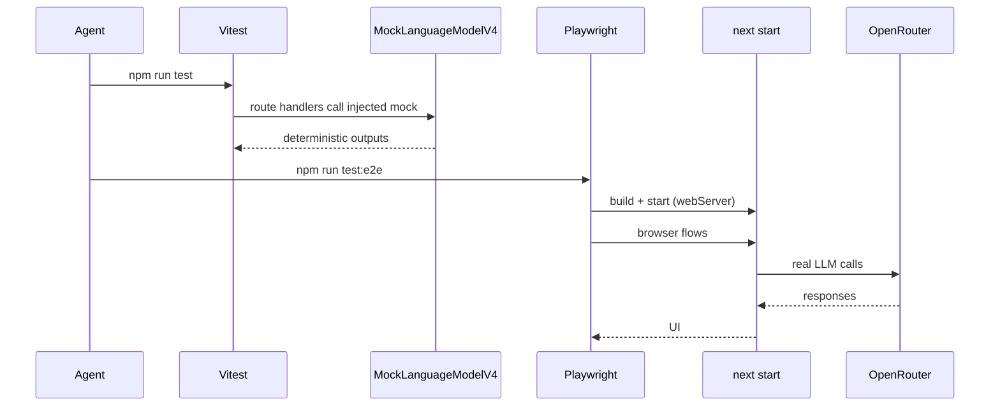

# ADR-001: Project Initialization, Tooling and Test Infrastructure

**Date:** 2026-11-25
**Status:** Accepted
**Relates to:** [`000-main-architecture.md`](000-main-architecture.md)

---

## 1. Scope

How the implementing agent turns the empty `app/` folder into a running Next.js 16 project with TypeScript strict, Tailwind 4, shadcn/ui, AI Elements, AI SDK, fonts, environment handling and the full test toolchain. It does not cover feature code (see ADR-002…004).

Versions verified with `npm view` on 2026-11-25. Pin these exact versions in commands so the setup is reproducible; upgrade deliberately later.

| Package | Version |
|---|---|
| `create-next-app` / `next` | 16.4.6 |
| `react` / `react-dom` | 19.3.1 |
| `tailwindcss` | 4.3.5 |
| `shadcn` (CLI) | 4.23.0 |
| `ai` | 7.0.181 |
| `@ai-sdk/react` | 4.0.186 |
| `@openrouter/ai-sdk-provider` | 3.1.0 (peer `ai ^7.0.0`, `zod ^3.25.76 \|\| ^4.1.8`) |
| `zod` | 4.6.7 |
| `streamdown` | 2.8.1 |
| `vitest` | 5.1.2 |
| `@vitejs/plugin-react` | 6.3.0 |
| `@playwright/test` | 1.65.1 |

---

## 2. Technology Documentation References

| Library | Context7 ID or official docs | Used for |
|---|---|---|
| create-next-app | https://nextjs.org/docs/app/api-reference/cli/create-next-app | Scaffolding |
| Next.js 16 | `/vercel/next.js` · bundled docs in `app/node_modules/next/dist/docs/` | Config, fonts, Route Handlers |
| shadcn CLI | https://ui.shadcn.com/docs/cli | `init`, `add` |
| AI Elements (shadcn) | https://ui.shadcn.com/docs/ai-elements (pattern pages also as `.md`) | Chat components |
| Vitest with Next.js | https://nextjs.org/docs/app/guides/testing/vitest | Unit/integration setup |
| Playwright with Next.js | https://nextjs.org/docs/app/guides/testing/playwright · https://playwright.dev/docs/test-webserver | E2E setup |
| AI SDK testing | `/vercel/ai` → "Testing" (`ai/test`) | LLM mocks |

---

## 3. Component Design — initialization procedure

Run every step from the repository root unless stated otherwise. Use npm (pnpm is not installed). Check `--help` of each CLI before running if a flag errors.

### Step 1 — Free the target folder
`create-next-app` refuses a folder that contains `README.md` (only `.git`, `.gitignore`, `LICENSE`, `docs`, IDE folders and similar are allowed). Move `app/README.md` to a temporary location with `git mv` (e.g. `docs/app-scaffold-checklist.md`), scaffold, then merge its checklist into the new `app/README.md` and delete the temporary file in the same commit.

### Step 2 — Scaffold Next.js
`npx create-next-app@16.4.6 app --ts --app --tailwind --eslint --src-dir --import-alias "@/*" --use-npm --disable-git --yes`

- `--disable-git`: the repository already exists.
- `--src-dir`: avoids the confusing `app/app/` path; routes live in `app/src/app/`.
- Turbopack is the default bundler in Next 16 (no flag needed).
- Keep the generated `app/AGENTS.md` (`--agents-md` default). It tells agents to read the version-matched docs in `node_modules/next/dist/docs/`. Extend it with the stack rules from §3 Step 9; this is the nested, stack-specific AGENTS.md that keeps the root file short.

### Step 3 — Harden TypeScript
`strict: true` is already generated. Add: `noUncheckedIndexedAccess`, `noImplicitOverride`, `noFallthroughCasesInSwitch`, `noImplicitReturns`, and set `allowJs: false`. Do **not** enable `exactOptionalPropertyTypes` (known friction with shadcn and AI SDK types). Add script `typecheck` = `tsc --noEmit`.

The repository rule `.github/instructions/TypeScript-React.instructions.md` (no `any`, no `as`, explicit types) applies to all hand-written code. Enforce it in ESLint with `@typescript-eslint/no-explicit-any: error` and `@typescript-eslint/consistent-type-assertions` with `assertionStyle: "never"`; use Zod parsing, type guards and `satisfies` instead of assertions (including `as const`). Generated vendor code in `src/components/ui/**` and `src/components/ai-elements/**` is excluded from these two rules only, and it must not be edited to add new assertions.

### Step 4 — shadcn/ui and AI Elements
From `app/`: `npx shadcn@4.23.0 init -t next -b radix -y` (Radix base; `-d` would select Base UI instead). Then add the base components needed by ADR-004 (button, input, textarea, label, select, radio-group, dialog, alert, card, badge; no toast library) and the AI Elements patterns from `ui.shadcn.com/docs/ai-elements`: the chat/conversation container, message with markdown response, prompt input, and shimmer/loader. Read each pattern's `.md` page first for the exact `shadcn add` command. Components land in `src/components/ui/` and `src/components/ai-elements/` and are owned code. Do not add attachment components (AC-27). Add `@source "../node_modules/streamdown/dist/*.js";` to `globals.css` if the message response component uses Streamdown.

### Step 5 — Runtime dependencies
From `app/`: install `ai@7.0.181`, `@ai-sdk/react@4.0.186`, `@openrouter/ai-sdk-provider@3.1.0`, `zod@4.6.7`, `server-only`. Dev: `@types/node` (already present).

### Step 6 — Brand assets and fonts
- Copy `assets/logo.webp` and `assets/favicon.ico` into `app/public/` (and `app/src/app/favicon.ico`).
- Copy the Titillium Web files into `app/src/fonts/`. Turbopack does not resolve files outside the project root, so referencing `../assets/fonts` is not allowed. Use woff2 where available (regular 400, bold 700, black 900, light italic, extra-light), woff for light 300, semibold 600 and italic. Skip `.eot` and `.ttf`. Load with `next/font/local` as a CSS variable `--font-titillium` and map it in Tailwind `@theme`.
- Note: `titilliumweb-italic-webfont.woff` and `titilliumweb-light-webfont.woff` are untracked in git on 2026-11-25; commit them to `assets/` first.
- Map `assets/design-tokens.json` (colors, typography, spacing, radius, shadows) into CSS variables in `globals.css` `@theme` and shadcn's semantic variables (`--primary`, `--background`, …). Details in ADR-004.

### Step 7 — Environment
- Create `app/.env.example` with the variables from ADR-000 §7 (no secret values). Update the root `.env.example` to say the app reads `app/.env.local`.
- The developer creates `app/.env.local` (gitignored by the template). `CASE_SIGNING_SECRET` is generated with `openssl rand -base64 32`.

### Step 8 — Test toolchain
- Unit/integration: dev-install `vitest@5.1.2 @vitejs/plugin-react@6.3.0 jsdom @testing-library/react @testing-library/dom @testing-library/user-event @testing-library/jest-dom vite-tsconfig-paths`. Configure two Vitest projects: `unit` (environment `jsdom`, `tests/unit/**`) and `integration` (environment `node`, `tests/integration/**`), with a setup file registering jest-dom matchers. Scripts: `test` = `vitest run`, `test:watch` = `vitest`.
- E2E: dev-install `@playwright/test@1.65.1` and `@axe-core/playwright` (accessibility checks, ADR-004 TAC-004-04); run `npx playwright install chromium firefox webkit`. `playwright.config.ts`: `testDir: tests/e2e`; `webServer` is an array of two real instances of the same production build — primary `npm run build && npm run start` on `http://localhost:3000` with the real `.env.local`, a failure instance `next start -p 3001` started with `OPENROUTER_API_KEY=invalid-e2e-key` (real OpenRouter authentication error, used only by AC-13 failure specs), and a timeout instance `next start -p 3002` with the real key plus `ALLOW_TEST_BUDGET=true CASE_BUDGET_MS=1000` (real timeout, ADR-003 A-05, used only by the AC-13 timeout spec); `reuseExistingServer: !process.env.CI`, timeout per test 120 s (real LLM), projects Chromium, Firefox, WebKit and a 360×740 mobile viewport. PRD AC-34 also names Edge: add a `channel: "msedge"` project only if Microsoft Edge is installed on the machine (`npx playwright install msedge` needs system privileges); otherwise Edge is covered by the Chromium engine and the gap is reported in the PR. Script `test:e2e`.
- Add `.playwright-cli/`, `test-results/`, `playwright-report/` to `.gitignore` if missing.

### Step 9 — Nested `app/AGENTS.md`
Keep it short and specific: exact commands (`npm run dev|build|start|lint|typecheck|test|test:e2e`), "AI SDK 7: read `/vercel/ai` docs, do not use v5/v6 names", "never import `lib/ai` or `lib/security` in client components", "all UI strings come from `copy-pl.ts`", "policy files are in `content/policies/`". Root `AGENTS.md` stays generic.

### Step 10 — Verify the scaffold
`npm run lint`, `npm run typecheck`, `npm run test` (one smoke test), `npm run build`, `npm run start` and load `/` — record each result separately (AGENTS.md verification rule). Commit as `Frontend: scaffold Next.js 16 app with shadcn, AI SDK and test tooling`.

---

## 4. Data Structures

| Artifact | Content |
|---|---|
| `app/package.json` scripts | `dev`, `build`, `start`, `lint`, `typecheck`, `test`, `test:watch`, `test:e2e` |
| `app/tsconfig.json` | strict + flags from Step 3, alias `@/*` → `src/*` |
| `app/components.json` | shadcn config (style, Radix base, aliases `@/components`, `@/lib`) |
| `app/vitest.config.mts` | projects `unit` (jsdom) and `integration` (node) |
| `app/playwright.config.ts` | webServer build+start, 4 projects |
| `app/.env.example` | variable names from ADR-000 §7 |

---

## 5. Interface Contracts

| Command | Expected result |
|---|---|
| `npm run dev` | Dev server on http://localhost:3000 with Turbopack |
| `npm run build && npm run start` | Production server on port 3000; fails if env validation fails |
| `npm run test` | Runs `unit` and `integration` projects, no network access to OpenRouter |
| `npm run test:e2e` | Builds, starts and runs Playwright; requires `app/.env.local` with a real key |

---

## 6. Technical Decisions

### S-01 create-next-app over starter templates
**Status:** Accepted · **Date:** 2026-11-25
**Context:** The app starts from an empty folder and the agent initializes it. Candidates: create-next-app, Vercel AI Chatbot template, Vercel Chat SDK scaffold (`create-chat-sdk`), shadcn `init` project mode.
**Decision:** `create-next-app@16.4.6` with flags above, then `shadcn init` on top.
**Rejected alternatives:**
- AI Chatbot template: brings auth, Postgres, Blob and AI Gateway that the PRD excludes.
- `create-chat-sdk`: scaffolds a Slack/Teams webhook bot, not a web UI.
- `shadcn init` creating the project: works but hides Next.js flags; create-next-app is the documented baseline.
**Consequences:** (+) minimal, known baseline; nothing to delete. (-) Chat UI assembled from components (covered by AI Elements).
**Review trigger:** If a maintained template matches "form + single chat, no DB" exactly.

### S-02 `src/` directory and policies inside the project
**Status:** Accepted · **Date:** 2026-11-25
**Context:** Without `--src-dir` the routes would be in `app/app/`. Policies must be readable at runtime.
**Decision:** Use `src/`; policies in `app/content/policies/`, loaded server-side.
**Consequences:** (+) clear paths; files included in the build. (-) PRD path `docs/policies/` differs — PRD 8.3 allows it; update PRD 8.3 when the files are created.
**Review trigger:** If policies become editable by staff (admin UI).

### S-03 Vitest + Playwright
**Status:** Accepted · **Date:** 2026-11-25
**Context:** AGENTS.md requires unit, integration and E2E layers. Next.js documents Vitest and Playwright.
**Decision:** Vitest 5 with two projects; Playwright 1.65 for E2E and Manual QA.
**Rejected alternatives:** Jest (slower ESM handling; AI SDK 7 is ESM-only), Cypress (no WebKit).
**Consequences:** (+) ESM-native, fast. (-) Async Server Components can't be unit-tested in Vitest — keep `page.tsx` thin and test it via E2E.
**Review trigger:** If Vitest 5 drops jsdom support used by RTL.

---

## 7. Diagrams

### Initialization flow

### Sequence — test execution layers

---

## 8. Testing Strategy

### Test scenarios for this area

| Scenario | Type | Input | Expected output | Edge cases |
|---|---|---|---|---|
| Scaffold builds | Build | `npm run build` | Exit 0, no warnings from config | Missing env → clear failure message |
| Strict flags active | Typecheck | file indexing an array without guard | `tsc` error | — |
| Env validation | Unit | missing `OPENROUTER_API_KEY` / short `CASE_SIGNING_SECRET` | Throws with variable name, no value printed | Overrides empty strings treated as unset |
| Fonts load | E2E | open `/` | Computed `font-family` contains Titillium Web | Font 404 → test fails |
| Smoke | E2E | open `/` | Form heading in Polish visible, no console errors | Mobile 360 px |

### Technical acceptance criteria

- TAC-001-01: Fresh clone + `npm ci` in `app/` + `npm run build` succeeds on Node 24.
- TAC-001-02: `tsconfig.json` contains `strict`, `noUncheckedIndexedAccess`, `noImplicitOverride`, `noFallthroughCasesInSwitch`, `noImplicitReturns`, `allowJs: false`.
- TAC-001-03: `npm run test` makes zero network requests (Vitest fails on unhandled fetch to `openrouter.ai`).
- TAC-001-04: No file under `app/` references `../assets/` at runtime.
- TAC-001-05: `app/.env.example` lists every variable read by the env validator; no secret values committed.
