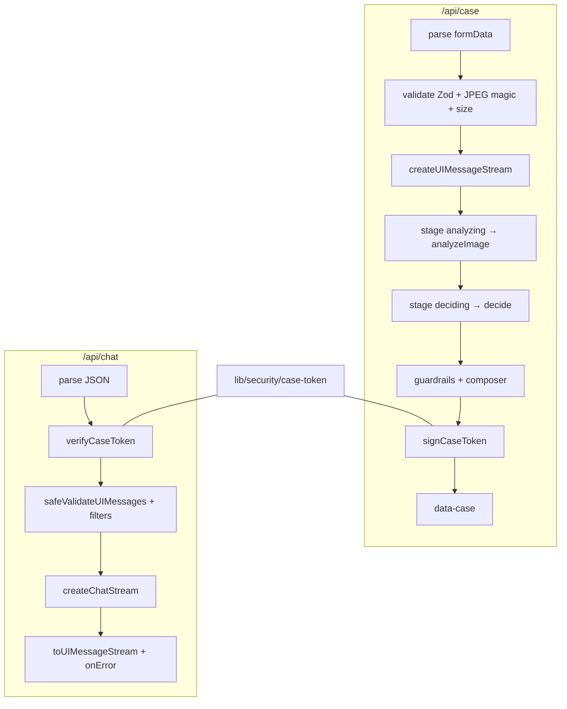
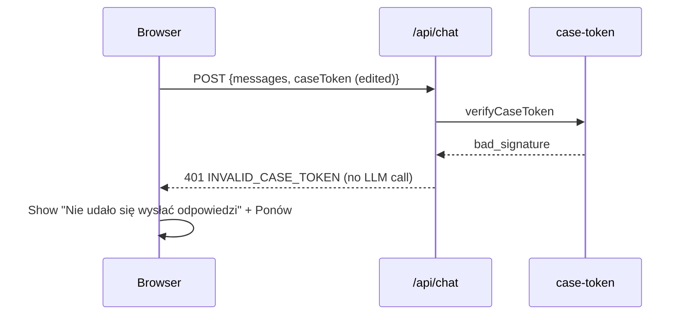
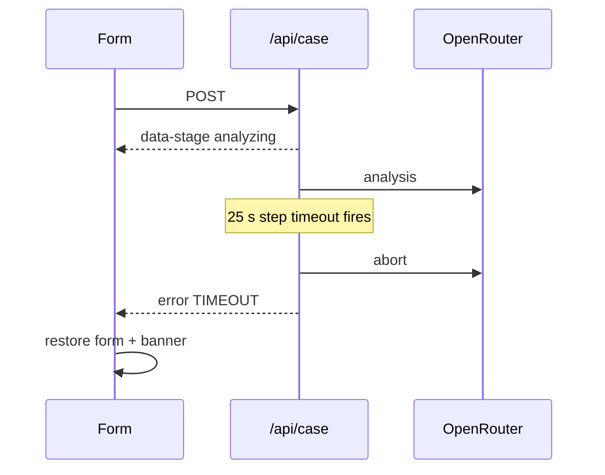

# ADR-003: API Routes, Case Token, Timeouts and Error Handling

**Date:** 2026-11-25
**Status:** Accepted
**Relates to:** [`000-main-architecture.md`](000-main-architecture.md)

---

## 1. Scope

The two Next.js Route Handlers (`src/app/api/case/route.ts`, `src/app/api/chat/route.ts`), their request/response contracts, server-side validation, the HMAC case token (`src/lib/security/`), time budgets, error mapping and logging. LLM prompting is in ADR-002; client consumption is in ADR-004.

---

## 2. Technology Documentation References

| Library | Context7 ID or official docs | Used for |
|---|---|---|
| Next.js Route Handlers | `/vercel/next.js` → `route.ts`, route segment config `maxDuration` | Endpoints |
| AI SDK UI streaming | `/vercel/ai` → "Streaming custom data", "Transport", "Error handling", `createUIMessageStream`, `createUIMessageStreamResponse`, `toUIMessageStream`, `safeValidateUIMessages` | Stream protocol |
| Node.js crypto | https://nodejs.org/api/crypto.html (`createHmac`, `timingSafeEqual`, `randomUUID`) | Token signing |
| Zod 4 | https://zod.dev | Request validation |

---

## 3. Component Design

| Component | Responsibility |
|---|---|
| `api/case/route.ts` | `POST` only. Exports `maxDuration = 60`. Parses `request.formData()`, validates, computes window, runs `analyzeImage` → `decide` → `applyGuardrails` → `composeFirstMessage` → `signCaseToken` inside `createUIMessageStream`, writing transient `data-stage` parts and one final `data-case` part. Returns `createUIMessageStreamResponse`. |
| `api/chat/route.ts` | `POST` only. Exports `maxDuration = 60`. Parses JSON, verifies token, validates messages, calls `createChatStream`, returns the stream via `toUIMessageStream` + `createUIMessageStreamResponse` with a Polish `onError` message. |
| `lib/security/case-token.ts` | `signCaseToken(payload)` → string `base64url(json).base64url(hmac)`; `verifyCaseToken(token, now)` → payload or typed failure (malformed, bad_signature, expired, unsupported_version). Uses `timingSafeEqual`. |
| `lib/server/request-guards.ts` | Content-type checks, size checks, JPEG magic bytes (`FF D8 FF`), one-submission-at-a-time is client-side (AC-09). |
| `lib/server/log.ts` | Structured `console` logging with allow-listed fields only. |

Both routes use the Node.js runtime (no `runtime` export). Both pass `AbortSignal.any([request.signal, AbortSignal.timeout(budget)])` to the AI layer so a closed browser tab or the budget aborts the upstream OpenRouter call.

---

## 4. Data Structures

### `POST /api/case` request — `multipart/form-data`

| Field | Type | Constraint |
|---|---|---|
| `caseType` | string | `zwrot` \| `reklamacja` |
| `category` | string | one of the 12 PRD 8.2 values (exact Polish strings) |
| `model` | string | trimmed length 2–100 |
| `purchaseDate` | string | `YYYY-MM-DD`, not after today in `APP_TIMEZONE`, not before 2000-01-01 |
| `reason` | string | ≤ 2000; for `reklamacja` ≥ 10 non-whitespace characters |
| `photo` | file | `image/jpeg`, starts with `FF D8 FF`, size ≤ 2 MB (client sends ≤ 1.5 MB) |
| `photoName` | string | original file name, ≤ 200 chars, only for display |

Server rejects requests whose `Content-Length` exceeds 2.2 MB before parsing.

### `POST /api/case` response — UI message stream (SSE)

| Part | When | Content |
|---|---|---|
| `data-stage` (transient, id `stage`) | after validation | `{ stage: "analyzing" }` |
| `data-stage` (transient, id `stage`) | after analysis | `{ stage: "deciding" }` |
| `data-case` | once, at the end | `{ caseId, firstMessage (UIMessage), decision (Decision), analysisSummaryPl, caseToken }` |
| error chunk | on failure | error text = machine code only: `VALIDATION_FAILED`, `PROCESSING_FAILED`, `TIMEOUT` |

Validation failures before the stream starts return HTTP 400 JSON `{ error: "VALIDATION_FAILED", fields: [names] }` (no stream). The client shows field errors from its own validation; server field errors are a safety net.

### `POST /api/chat` request — JSON

| Field | Type | Constraint |
|---|---|---|
| `id` | string | chat ID from `useChat` (= caseId) |
| `messages` | UIMessage[] | 2–40 messages; last message role `user`; user text 1–2000 chars, not whitespace-only; no file parts (AC-27) |
| `caseToken` | string | ≤ 16 KB |
| `trigger` | string | `submit-message` \| `regenerate-message` (from AI SDK transport) |

Body limit: 256 KB.

### `POST /api/chat` response

UI message stream consumed by `useChat`: `start`, `text-start/delta/end`, optional `tool-issueUpdatedDecision` input/output parts, `finish`. On error: error chunk with Polish text "Nie udało się wysłać odpowiedzi" (the client shows its own copy too).

### `CaseToken`

Payload `{ v: 1, caseId, input (no photo), analysis, decision, window, issuedAt, expiresAt }` → JSON → base64url; signature = HMAC-SHA256(secret, payloadB64) → base64url; token = `payloadB64 + "." + signatureB64`. Expiry 2 hours. The payload is readable by the client (not encrypted) — it contains only data the customer entered and the decision they see.

---

## 5. Interface Contracts

| Endpoint | Success | Errors |
|---|---|---|
| `POST /api/case` | 200 stream ending with `data-case` | 400 `VALIDATION_FAILED` (JSON); 413 `PAYLOAD_TOO_LARGE`; 415 `UNSUPPORTED_MEDIA_TYPE`; in-stream `PROCESSING_FAILED` / `TIMEOUT`; 405 for other methods; 500 `CONFIG_ERROR` when env invalid |
| `POST /api/chat` | 200 stream | 400 `INVALID_MESSAGES`; 401 `INVALID_CASE_TOKEN` (missing, malformed, bad signature, expired); 413; in-stream error; 405 |

Notes: no auth (PRD 7); no CORS headers (same-origin only); responses set `Cache-Control: no-store`. No endpoint echoes internal error messages, provider names or stack traces to the client.

### Time budgets

| Path | Budget | Mechanism |
|---|---|---|
| Client submission | 60 s | `AbortController` timer in the form (AC-13) |
| `/api/case` total | 55 s | `AbortSignal.timeout(55000)` combined with `request.signal` |
| Analysis step | 25 s | AI SDK `timeout.totalMs` |
| Decision step | 25 s | AI SDK `timeout.totalMs` |
| `/api/chat` | 45 s total, first chunk 15 s | AI SDK `timeout` (ADR-002 §3.5) |
| Route segment | `maxDuration = 60` | Next.js config |

---

## 6. Technical Decisions

### A-01 Stream stage events from `/api/case` instead of two client calls
**Status:** Accepted · **Date:** 2026-11-25
**Context:** AC-12 needs stage text; AC-13 needs one 60 s budget and no partial decision.
**Decision:** One request; the server writes transient `data-stage` parts via `createUIMessageStream` and the final `data-case` part. The client reads it with the AI SDK stream reader (see ADR-004), not `useChat`.
**Rejected alternatives:**
- Two endpoints (`/api/analyze`, `/api/decide`) called in sequence: the analysis result would round-trip through the client and need signing too; two budgets.
- Fake client-side stage timer: stage text would not reflect real progress.
**Consequences:** (+) real progress, single budget, no intermediate data exposed. (-) The form reads a UI message stream outside `useChat` (small custom reader).
**Review trigger:** If a background job queue is introduced.

### A-02 multipart/form-data for the photo
**Status:** Accepted · **Date:** 2026-11-25
**Context:** The photo is binary; base64 in JSON adds ~33 %.
**Decision:** `FormData` upload of the downscaled JPEG; server converts to `Uint8Array` for the AI SDK file part.
**Rejected alternatives:** Base64 JSON (larger payload); upload to Blob storage (persistence is out of scope).
**Consequences:** (+) small request, simple validation. (-) Route test fixtures must build `FormData` with a `Blob`.
**Review trigger:** If photos must be kept for staff review (later feature).

### A-03 HMAC token, not encryption
**Status:** Accepted · **Date:** 2026-11-25
**Context:** We need integrity, not secrecy: the customer already sees all token content.
**Decision:** HMAC-SHA256 signature with `CASE_SIGNING_SECRET`; constant-time compare; versioned payload; 2 h expiry.
**Rejected alternatives:** JWE/encryption (extra dependency, no added value); JWT library (unneeded dependency for one claim set).
**Consequences:** (+) zero dependencies, easy to test. (-) Secret rotation invalidates open chats (acceptable).
**Review trigger:** If token payload starts carrying data the customer must not see.

### A-04 Error codes only, Polish copy on the client
**Status:** Accepted · **Date:** 2026-11-25
**Context:** AI SDK masks errors by default; AC-13 and AC-28 define exact Polish texts.
**Decision:** Server sends machine codes; client maps codes to strings in `copy-pl.ts`.
**Consequences:** (+) no leakage of provider errors; one place for copy. (-) Two layers to keep in sync — covered by integration tests.
**Review trigger:** None for PoC.

---

## 7. Diagrams

### Component diagram

### Sequence — token verification failure

### Sequence — timeout on `/api/case`

---

## 8. Testing Strategy

### Test scenarios for this area

| Scenario | Type | Input | Expected output | Edge cases |
|---|---|---|---|---|
| Case happy path | Integration | valid FormData, mock models | stream: stage analyzing, stage deciding, data-case with valid token | reason empty for zwrot |
| Missing field | Integration | no `model` | 400 VALIDATION_FAILED, fields [model] | each required field |
| Complaint short reason | Integration | reklamacja, reason "abc" | 400 | 10 chars with spaces |
| Future purchase date | Integration | today+1 (Warsaw) | 400 | 23:30 UTC boundary |
| Wrong file type | Integration | PNG bytes labelled image/jpeg | 415 | GIF, empty file |
| Too large | Integration | 2.1 MB JPEG | 413 | Content-Length missing |
| Analysis fails | Integration | mock throws | stream error PROCESSING_FAILED, no data-case | schema-invalid JSON |
| Budget | Integration | mock hangs (fake timers) | TIMEOUT before 55 s | client abort closes upstream call |
| Token sign/verify | Unit | payload | round-trip equal | altered byte, wrong secret, expired, v=2 |
| Chat valid | Integration | 2 messages + token, mock stream | text stream | regenerate trigger |
| Chat bad token | Integration | edited payload | 401, mock not called | missing token |
| Chat message rules | Integration | 2001 chars / whitespace / file part / 41 messages | 400 INVALID_MESSAGES | system role message dropped |
| Logging | Unit | run case route | log lines contain caseId, step, ms, model; not reason/image/messages | error path |

### Technical acceptance criteria

- TAC-003-01: `/api/case` never emits `data-case` unless both LLM steps succeeded and guardrails ran.
- TAC-003-02: `/api/case` emits `data-stage` `analyzing` before the first LLM call and `deciding` before the second.
- TAC-003-03: Any token whose payload or signature differs by one byte, or whose `expiresAt` is past, yields 401 with zero LLM calls.
- TAC-003-04: Aborting the client request aborts the upstream LLM call (mock observes `abortSignal.aborted === true`).
- TAC-003-05: All error responses contain only codes from §5; no stack traces or provider messages (asserted in tests).
- TAC-003-06: Both routes respond `Cache-Control: no-store` and reject non-POST methods with 405.
