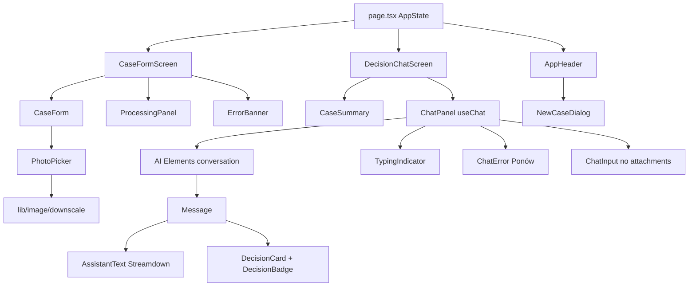
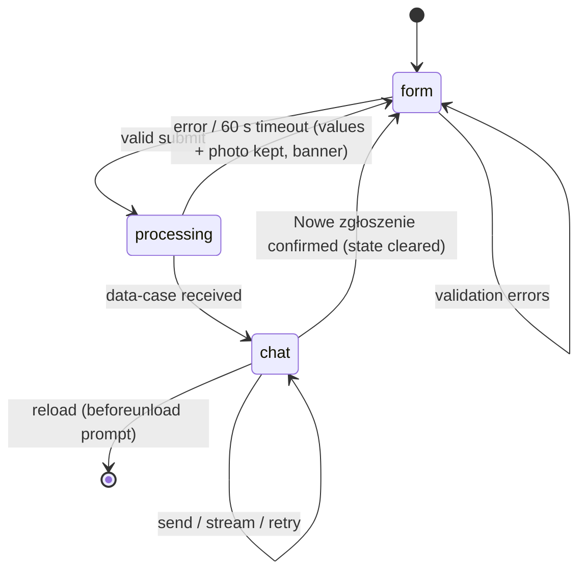
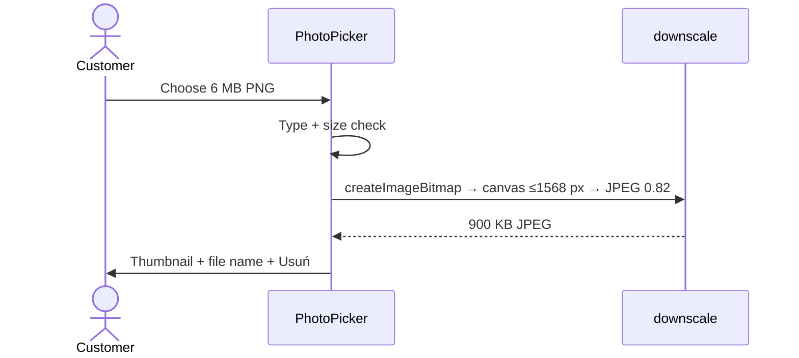
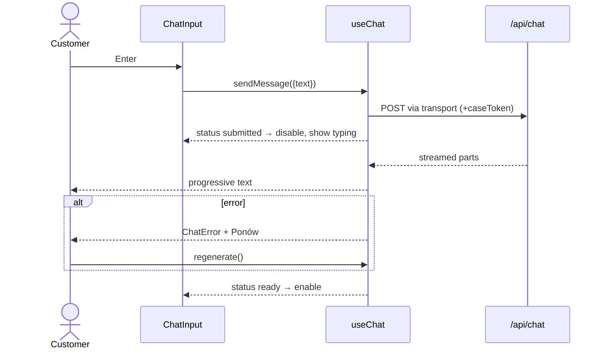

# ADR-004: Frontend — Screens, State, Chat UI (AI Elements), Image Downscaling and Design Tokens

**Date:** 2026-11-25
**Status:** Accepted
**Relates to:** [`000-main-architecture.md`](000-main-architecture.md)

---

## 1. Scope

Client-side code in `src/app/page.tsx`, `src/components/**` and `src/lib/image/`: the Form and Decision chat screens (PRD 9), client state and session rules, consumption of `/api/case` and `/api/chat`, AI Elements integration, image downscaling, design token mapping and accessibility. Server logic is in ADR-002/003.

---

## 2. Technology Documentation References

| Library | Context7 ID or official docs | Used for |
|---|---|---|
| `@ai-sdk/react` 4 (`useChat`) | `/vercel/ai` → `07-reference/02-ai-sdk-ui/01-use-chat`, "Transport", "Error handling", "Streaming custom data" | Chat state, streaming, retry |
| AI SDK UI stream reading | `/vercel/ai` → `readUIMessageStream` / UI message stream protocol | Reading `/api/case` stream in the form |
| AI Elements (shadcn) | https://ui.shadcn.com/docs/ai-elements (pattern `.md` pages) | Conversation container, message, markdown response, prompt input, shimmer |
| shadcn/ui | https://ui.shadcn.com/docs | Button, Input, Textarea, Label, Select, RadioGroup, Dialog, Alert, Card, Badge |
| Streamdown | https://streamdown.ai | Markdown streaming render (AC-29) |
| Tailwind CSS 4 | https://tailwindcss.com/docs/theme | `@theme` tokens |
| `next/font/local` | `/vercel/next.js` → fonts | Titillium Web |
| MDN `createImageBitmap`, `HTMLCanvasElement.toBlob` | https://developer.mozilla.org/docs/Web/API/Window/createImageBitmap | Downscaling |

---

## 3. Component Design

### 3.1 Component tree

| Component | Type | Responsibility |
|---|---|---|
| `app/layout.tsx` | Server | `<html lang="pl">`, Titillium font variable, metadata (title "Hardware Service Decision Copilot"), favicon |
| `app/page.tsx` | Client | Owns `AppState` (§4); renders `CaseFormScreen` or `DecisionChatScreen`; registers `beforeunload` while in chat (AC-31) |
| `AppHeader` | Client | Logo (`/logo.webp`, alt "Logo"), product name, on chat screen case-type label + "Nowe zgłoszenie" button |
| `CaseFormScreen` | Client | Intro text, `CaseForm`, `ProcessingPanel`, `ErrorBanner` |
| `CaseForm` | Client | Fields per PRD 9.1 in order; Zod client schema (shared from `lib/domain`); errors on blur and submit; focus first invalid field; disables all inputs while processing (AC-09) |
| `PhotoPicker` | Client | Drop zone + "Wybierz plik" button, type/size checks (AC-07), thumbnail + file name + "Usuń"/replace (AC-08), case-type hint text; triggers downscaling after selection |
| `ProcessingPanel` | Client | `aria-live="polite"` stage text "Analizujemy zdjęcie…" / "Przygotowujemy decyzję…" with AI Elements shimmer |
| `ErrorBanner` | Client | `role="alert"`, text "Nie udało się przetworzyć zgłoszenia. Spróbuj ponownie." + "Spróbuj ponownie" (re-submits the preserved values) |
| `DecisionChatScreen` | Client | Layout: `CaseSummary` (side column ≥1024 px; collapsible above messages on mobile) + `ChatPanel` |
| `CaseSummary` | Client | Read-only case type, category, model, purchase date (format `dd.MM.yyyy`), reason (3 lines + "Pokaż więcej"), thumbnail opening a Dialog with the large image (AC-21) |
| `ChatPanel` | Client | `useChat` instance; AI Elements conversation container (auto-scroll, AC 9.2); maps parts to components; `ChatInput` |
| `DecisionCard` | Client | Renders `data-decision` and `tool-issueUpdatedDecision` output: title ("Decyzja" or "Zaktualizowana decyzja"), `DecisionBadge`, "Uzasadnienie", cited rules, numbered "Kolejne kroki", optional photo problem, change reason (updated), disclaimer in muted text |
| `DecisionBadge` | Client | Label with icon + text + color per §3.4; never color alone |
| `AssistantText` | Client | AI Elements message response (Streamdown markdown); headings, bold, lists; raw markers never visible (AC-29) |
| `ChatInput` | Client | AI Elements prompt input **without attachment controls** (AC-27): textarea, counter "x/2000", "Wyślij"; Enter sends, Shift+Enter newline; disabled while `status` is `submitted`/`streaming`; blocks empty/whitespace (AC-22) |
| `TypingIndicator` | Client | Shimmer "Asystent pisze…" while `status === 'submitted'` or streaming with no text yet (AC-23) |
| `ChatError` | Client | Under the last user message when `error` is set: "Nie udało się wysłać odpowiedzi" copy from `copy-pl.ts` + "Ponów" → `regenerate()` (AC-28) |
| `NewCaseDialog` | Client | shadcn Dialog: "Rozpocząć nowe zgłoszenie? Obecna rozmowa zostanie utracona." with "Anuluj" / "Rozpocznij nowe" (AC-32) |

All user-visible strings come from `lib/domain/copy-pl.ts`.

### 3.2 Submitting the case (`/api/case`)

1. `CaseForm` validates; on success `page.tsx` sets `phase = processing`.
2. Build `FormData` with fields + downscaled JPEG; start an `AbortController` with a 60 s timer.
3. `fetch('/api/case', { method: 'POST', body, signal })`. On HTTP ≥ 400 → error state.
4. Read the body with the AI SDK UI message stream reader. On each `data-stage` part update the stage text; on `data-case` store `caseToken`, `decision`, `firstMessage`, `analysisSummaryPl`; on error chunk or stream end without `data-case` → error state.
5. Success → `phase = chat`. Error/timeout → `phase = form` with all values and the photo preserved, banner shown (AC-13).

Only one submission at a time: the submit handler returns early while `phase = processing`.

### 3.3 Chat (`/api/chat`) with `useChat`

- `useChat({ id: caseId, messages: [firstMessage], transport: new DefaultChatTransport({ api: '/api/chat', prepareSendMessagesRequest }) })`. `prepareSendMessagesRequest` sends `{ id, messages, caseToken, trigger }` — the token is read from the current `AppState`, never from a hidden input.
- Typed UI message: data part schema `decision` and tool `issueUpdatedDecision` so `message.parts` are typed.
- Part rendering: `text` → `AssistantText` (assistant) or plain text bubble (user); `data-decision` → `DecisionCard kind=initial`; `tool-issueUpdatedDecision` in state `output-available` → `DecisionCard kind=updated`; other tool states → nothing (the text that follows explains).
- Sending: `sendMessage({ text })` only when `status === 'ready'` and text is valid.
- Errors: `error` set → `ChatError` + `regenerate()`. The user message stays (AC-28).
- Layout: assistant messages left, customer right (PRD 9.2).

### 3.4 Design tokens and visual rules

Tokens come from `assets/design-tokens.json` / `docs/design-guidelines.md` and are mapped in `globals.css` `@theme` and shadcn semantic variables:

| shadcn / app variable | Token | Value |
|---|---|---|
| `--primary` | `brand.primary` | `#E2007A` |
| `--primary-foreground` | `text.onBrand` | `#FFFFFF` |
| `--background` | `background.default` | `#FFFFFF` |
| `--muted` | `background.light` | `#FAFAFA` |
| `--muted-foreground` | `text.muted` | `#555555` |
| `--foreground` | `text.primary` | `#000000` |
| `--border`, `--input` | `border.default` | `#B7B7B7` |
| `--accent` | `background.accentLight` | `#DCF3F4` |
| `--ring` | `brand.primary` | `#E2007A` |
| `--radius` | inputs `md` | 5 px; buttons 4 px; cards 20 px |
| Shadow `card` | `shadows.card` | `0 10px 24px rgba(33,33,33,.10)` |
| Font | Titillium Web | `"Titillium Web", Arial, sans-serif` |

The design guidelines leave status colors to an ADR and forbid magenta for errors. **Defined here** (all text colors pass WCAG AA on their background):

| Purpose | Background | Text / icon | Border |
|---|---|---|---|
| Zaakceptowano / success | `#E7F5EC` | `#1B6B36` | `#1B6B36` |
| Odrzucono / error, field errors | `#FDECEC` | `#B3261E` | `#B3261E` |
| Wymaga weryfikacji pracownika | `#FFF7D1` | `#6B4E00` | `#C9A400` |
| Info / processing panel | `#DCF3F4` | `#000000` | `#73DADF` |

Primary button: magenta, white 16 px/600 text, 4 px radius, min height 44 px (touch target; larger than the site's 30 px for accessibility). Cards: white, 20 px radius, `card` shadow. Inputs: 1 px `#B7B7B7`, 5 px radius, 16 px text. Turquoise only for borders/decoration. Spacing on a 4 px grid. Compare screenshots with `assets/homepage.png` during Manual QA.

### 3.5 Image downscaling (`lib/image/downscale.ts`)

1. Reject before decoding: type not in {image/jpeg, image/png, image/webp} → "Dozwolone formaty: JPG, PNG, WebP"; size > 10 MB → "Plik przekracza limit 10 MB" (AC-07).
2. Decode with `createImageBitmap(file, { imageOrientation: 'from-image' })`.
3. Scale so the longest edge ≤ 1568 px (never upscale); draw onto a canvas (OffscreenCanvas where available) with a white background (PNG transparency → white).
4. Encode `image/jpeg` quality 0.82; if > 1.5 MB, retry 0.7 then 0.6; if still > 1.5 MB, scale the edge to 1280 px and retry once. Verify the returned `blob.type` is `image/jpeg`.
5. Decoding failure → "Nie udało się odczytać zdjęcia. Wybierz inny plik." and the file is not accepted.
6. Thumbnail uses an object URL of the **original** file; revoked on remove, replace and new case.

Downscaling runs after selection (not on submit), so the submit is instant and failures appear next to the field.

---

## 4. Data Structures

| State (`page.tsx`) | Fields |
|---|---|
| `AppState` | `phase` (form \| processing \| chat), `formValues` (CaseInput draft), `photo` {originalFile, previewUrl, jpegBlob, name} \| null, `stage` (analyzing \| deciding \| null), `submitError` (code \| null), `caseSession` {caseId, caseToken, decision, firstMessage, analysisSummaryPl} \| null |

No `localStorage`, `sessionStorage`, cookies or IndexedDB (AC-30). A reload therefore always shows the empty form.

---

## 5. Interface Contracts

| Consumer | Endpoint | Contract (see ADR-003) |
|---|---|---|
| `CaseFormScreen` | `POST /api/case` | multipart in; stream with `data-stage`, `data-case`, error codes out |
| `ChatPanel` (`useChat`) | `POST /api/chat` | `{ id, messages, caseToken, trigger }` in; UI message stream out |

Error code → copy mapping (`copy-pl.ts`): `VALIDATION_FAILED`, `PROCESSING_FAILED`, `TIMEOUT`, `PAYLOAD_TOO_LARGE`, `UNSUPPORTED_MEDIA_TYPE` → AC-13 banner text; any chat error → AC-28 text.

---

## 6. Technical Decisions

### F-01 Plain `useChat` + AI Elements instead of assistant-ui
**Status:** Accepted · **Date:** 2026-11-25
**Context:** One thread, no persistence, custom decision cards, Polish copy, no attachments.
**Decision:** `useChat` drives AI Elements components directly; custom parts rendered by our components.
**Rejected alternatives:** assistant-ui runtime (extra abstraction, adapter package for AI SDK 7 still settling); building everything by hand (markdown streaming and scroll edge cases).
**Consequences:** (+) full control over rendering of `data-decision` and tool parts. (-) We wire status/error/retry ourselves (small).
**Review trigger:** If multi-thread history or branching is needed.

### F-02 Single page with in-memory screen switch
**Status:** Accepted · **Date:** 2026-11-25
**Context:** AC-30: reload returns to an empty form; no deep links needed.
**Decision:** One route `/`; `phase` state switches screens; no URL change.
**Rejected alternatives:** `/chat` route (reload would land on a chat without state, needs a redirect).
**Consequences:** (+) AC-30 holds by construction. (-) Browser back button leaves the app (acceptable; `beforeunload` warns during chat).
**Review trigger:** When sessions become persistent.

### F-03 Decision rendered from structured data, not markdown
**Status:** Accepted · **Date:** 2026-11-25
**Context:** PRD 9.2 requires visually distinct labels for the three decisions, including updated ones.
**Decision:** `DecisionCard` renders from `Decision` (data part or tool output); free-form assistant text uses markdown.
**Consequences:** (+) consistent badges and disclaimer. (-) Two render paths for assistant content.
**Review trigger:** None.

---

## 7. Diagrams

### Component diagram

### State diagram

### Sequence — photo selection

### Sequence — chat send, stream, error, retry

---

## 8. Testing Strategy

### Test scenarios for this area

| Scenario | Type | Input | Expected output | Edge cases |
|---|---|---|---|---|
| Field order and labels | Unit (RTL) | render form | 6 fields in PRD order, visible labels (AC-01, AC-35) | — |
| Required fields | Unit | submit empty | "To pole jest wymagane" on 5 fields, focus on first | — |
| Complaint reason | Unit | reklamacja + "krótko" | "Opisz powód reklamacji (min. 10 znaków)" | 10 chars incl. spaces |
| Limits and counter | Unit | type 2001 chars | input stops at 2000; counter "2000/2000" | paste |
| Future date | Unit | tomorrow | "Data zakupu nie może być z przyszłości" | date picker disables future days |
| Photo type/size | Unit | GIF; 11 MB JPEG | AC-07 messages, file not kept | HEIC |
| Downscale | Unit (mocked canvas/createImageBitmap) | 4000×3000 PNG | JPEG ≤1568 px edge, ≤1.5 MB, type image/jpeg | portrait EXIF; transparent PNG |
| Processing UI | Unit | mocked stream with two stages | stage texts in order, fields disabled | double click submit → one request |
| Error restore | Unit | mocked stream error | form values + photo kept, banner + retry | timeout via fake timers 60 s |
| Decision card | Unit | three labels | distinct badge text + icon + color; disclaimer present | updated kind shows "Zaktualizowana decyzja" |
| Markdown | Unit | "**pogrubienie**\n1. krok" | `<strong>`, `<ol>`; no `**` visible | partial markdown while streaming |
| Chat input | Unit | whitespace; Shift+Enter | not sent; newline | disabled while streaming |
| No attachments | Unit | render ChatInput | no file input or attach button | drag-drop file ignored |
| Chat retry | Unit | useChat error state | message kept, "Ponów" calls regenerate | — |
| New case dialog | Unit | confirm / cancel | cleared / unchanged | object URL revoked |
| Full return flow | E2E | `phone-1.jpg`, zwrot, today−3 | chat with decision card | Firefox, WebKit |
| Full complaint flow + chat | E2E | `laptop-1.png`, reklamacja, today−11 months, follow-up "Jaki model zgłosiłem?" | answer contains model | 360 px viewport |
| Keyboard only | E2E | Tab/Enter/Space through whole flow | case submitted, message sent | dialog focus trap |
| Reload | E2E | reload in chat | beforeunload dialog; then empty form | — |
| No horizontal scroll | E2E | 360 px | `scrollWidth <= clientWidth` on both screens | long model name |

### Technical acceptance criteria

- TAC-004-01: No client component imports `lib/ai`, `lib/security` or `server-only` modules (build fails otherwise).
- TAC-004-02: The image sent to `/api/case` is always `image/jpeg`, ≤ 1.5 MB, longest edge ≤ 1568 px (asserted on the request in an integration-style unit test).
- TAC-004-03: Every visible string is sourced from `copy-pl.ts`; a test fails if a JSX text literal outside that file contains letters (lint rule or test scan).
- TAC-004-04: Axe (via `@axe-core/playwright`) reports zero serious/critical violations on both screens.
- TAC-004-05: Decision badges meet ≥ 4.5:1 contrast and include an icon and text label.
- TAC-004-06: No browser storage API is called anywhere in `src/` (grep test).
