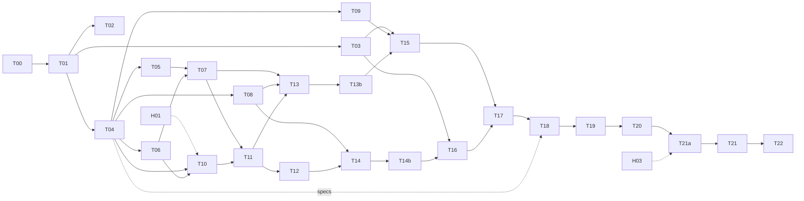

# Implementation Plan — Hardware Service Decision Copilot PoC

**Status:** APPROVED for local execution (gate G1, human 2026-11-26: OpenRouter cap $5, OpenCode yes, Codex no; remaining decisions delegated to the orchestrator and recorded in §8). Execution starts when the human runs `/goal`. Push, PR and merge still need separate approval (G4, G5).
**Date:** 2026-11-26 (revision 7: skill-test findings — curl denied, test-photo folder rules, stale baseline; revision 6: approved, decisions recorded, OpenCode verified; revision 5: QA screenshots kept in the repo, final ffmpeg demo video in the PR; revision 4: `CASE_BUDGET_MS` amendment accepted — real timeout E2E; revision 3: every mock traced to a real capture, failure ACs exercised for real)
**Scope:** The whole PoC defined by [`docs/PRD.md`](../PRD.md) (all flows 4.1–4.7 and AC-01…AC-36), implemented as one slice and delivered in one pull request. Context and scale: [PRD 1.1](../PRD.md#11-context-and-scale) (mid-size retailer, internal PoC, ~5 testers, synthetic data, GDPR before real photos).
**Architecture:** [ADR-000](../ADR/000-main-architecture.md), [ADR-001](../ADR/001-project-setup.md), [ADR-002](../ADR/002-ai-pipeline.md), [ADR-003](../ADR/003-api-routes.md), [ADR-004](../ADR/004-frontend.md) (diagrams: architecture, data flow, sequences, state — in the ADRs; this plan adds only the task dependency picture in §5)
**Design guidance:** [`docs/design-guidelines.md`](../design-guidelines.md), `assets/design-tokens.json`, `assets/homepage.png`; status colors in [ADR-004 §3.4](../ADR/004-frontend.md#34-design-tokens-and-visual-rules)
**Run mode:** written for one autonomous run (`/goal implement this plan: @docs/plans/poc-implementation-plan.md`) with human checks at the gates in §9; it can also be executed phase by phase.

---

## 1. Baseline — what actually exists (inspected 2026-11-26)

| Item | Observed state |
|---|---|
| Checkout | Worktree `.claude/worktrees/skills-lock`, branch `design-system` (tracks `origin/design-system`), HEAD `bd7aecd` (pushed, in sync with origin; refreshed in revision 7). `main` (`42895f3`) has neither PRD nor ADRs. The main checkout (`feat/moja-aplikacja`) is not touched. |
| Working tree | Only untracked `assets/fonts/titillium-web/titilliumweb-{italic,light}-webfont.woff` (needed by ADR-001 Step 6; committed in T00). PRD, ADRs, plan, skill and `.mcp.json` fix are committed. |
| Agent permissions | `.claude/settings.json` denies `Bash(curl:*)`, `Bash(wget:*)`, `Bash(sudo:*)`, force pushes and pushes to `main`/`master`/`prod`. The plan therefore uses Node `fetch` scripts instead of curl, and sudo steps are human `!` commands. |
| Test photos | `assets/example-images/README.md` (folder rules, Polish): upload tests use only the five real photos via the real form (`setInputFiles`); never generate images, illustrations or empty files; never tell the model what a photo shows; tests check the model's actual assessment and must not presume it. `laptop-1.png` is JPEG content with a `.png` name (3024×3135, 1.2 MB). The README asks that root `AGENTS.md` points to the folder (done in T00). |
| Application | `app/` contains only `README.md`. No `package.json`, source, entry points, tests or lockfile. |
| Specification | PRD, ADR-000…004, design guidelines, tokens, logo, favicon, fonts, synthetic photos `assets/example-images/{laptop-1.png, laptop-2.webp, phone-1.jpg, phone-2.jpeg, phone-3.jpeg}`. |
| Missing inputs | Policy files (created in T06). No `.env.local`; `OPENROUTER_API_KEY` not set. |
| Tracker | GitHub Issues disabled on the fork; no PRs or boards. **The Status column in §4 is the tracker** (human decision 2026-11-26). |
| CI / review automation | `.github/workflows/pr-agent-azure-review.yml` runs only if Azure variables are configured on the fork (not verified). |
| Agent roles | No `.claude/agents/`, `.codex/agents/` or OpenCode agents. `.codex/config.toml` has `multi_agent = true`. |

### Commands verified

| Command | Result |
|---|---|
| `node --version` / `npm --version` | `v24.21.0` / `11.19.0`; pnpm not installed (npm is used) |
| `gh --version` | `2.102.0`; `gh issue list` → "repository has disabled issues" |
| `codex --version` | `codex-cli 0.162.1`; `codex exec -m <MODEL>` exists (`codex exec --help`) |
| `claude` (this session) | Claude Code with `Agent` tool and `model` override (haiku/sonnet/opus) — verified by use |
| `opencode` | Installed 2026-11-26 with `npm install -g --prefix ~/.local opencode-ai@1.19.6` (global prefix needs root) → `~/.local/bin/opencode`, `opencode --version` = `1.19.6`. `opencode run --help` verified (`-m`, `--format json`, `-f/--file`, `--dir`, `--agent`; `--auto` marked dangerous). `opencode models` lists free models incl. `opencode/deepseek-v4.1-flash-free`, `opencode/mimo-v2.6-flash-free`. Smoke test `opencode run -m opencode/deepseek-v4.1-flash-free "Reply with exactly: OPENCODE_OK"` → `OPENCODE_OK` |
| `gh copilot --version` | Copilot CLI not installed; no Copilot VS Code extension |
| `npm --prefix app run build` | **Baseline failure (expected):** `ENOENT … app/package.json` |

App commands after T01 (run in `app/`): `npm run lint`, `npm run typecheck`, `npm run test`, `npm run build`, `npm run start`, `npm run test:e2e` ([ADR-001 §5](../ADR/001-project-setup.md#5-interface-contracts)).

---

## 2. Instructions in force (all levels checked 2026-11-26)

| Level | Source | Applies to | Effect on this plan |
|---|---|---|---|
| Organization | Claude organization instructions (admin-managed, injected into Claude sessions) | Claude Code sessions | Coaching/teaching tone in reports; no technical constraints |
| User, cloud | claude.ai profile preferences | Claude sessions | Not visible to the agent; none known |
| User, local | `~/.claude/rules/context7.md` (exists); `~/.claude/CLAUDE.md`, `~/.codex/AGENTS.md`, `~/.config/opencode/AGENTS.md` absent | Claude Code | Use Context7 for library questions |
| Project root | [`AGENTS.md`](../../AGENTS.md); [`CLAUDE.md`](../../CLAUDE.md) (imports AGENTS.md + Context7 rule); [`.github/copilot-instructions.md`](../../.github/copilot-instructions.md) | All agents (Codex and OpenCode read AGENTS.md; Claude via CLAUDE.md) | TDD, real captures before mocks, Manual QA, commit rules, no push without request, course-materials off-limits |
| Path-scoped | [`.github/instructions/TypeScript-React.instructions.md`](../../.github/instructions/TypeScript-React.instructions.md), [`tests.instructions.md`](../../.github/instructions/tests.instructions.md) | Copilot natively; **adopted for all workers in this plan** | No `any`, no `as`, explicit types (ESLint, ADR-001 Step 3); behavior-focused tests |
| Module | `app/AGENTS.md` — created in T01 (ADR-001 Step 9) | All agents inside `app/` | Stack commands, AI SDK 7 naming, server-only boundaries |
| Folder | none planned | — | — |

Every brief repeats the rules a worker needs; workers are not expected to discover them.

---

## 3. Execution model

### Roles, models and the headless commands

| Role | Mechanism (verified?) | Model / provider | Responsibility |
|---|---|---|---|
| Orchestrator | This Claude Code session (verified) | Claude Opus 5.5, Anthropic | Decisions, contradictions, shared contracts, briefs, diff review, re-running checks, integration, commits, plan status |
| Worker (default) | Claude Code `Agent` tool, `model: haiku` (verified) | Claude Haiku 5.5 | One bounded task per brief |
| Worker (escalation) | Same, `model: sonnet` (verified) | Claude Sonnet 5.5 | After evidence a task exceeds Haiku (§7) |
| Worker (always-available fallback) | OpenCode headless (installed and verified 2026-11-26). Command from the repo root: `opencode run -m opencode/deepseek-v4.1-flash-free --dir . --format json -f docs/.agent-briefs/<brief>.md "Execute the attached brief. Edit only its listed files. Report per its Report section." < /dev/null > .opencode-runs/<task-id>.jsonl` (no `--auto`; the run log folder is gitignored) | `opencode/deepseek-v4.1-flash-free` (free); alternative `opencode/mimo-v2.6-flash-free`; re-check `opencode models` on the day | Same as default worker when Claude quota is exhausted |
| Codex | Not used (human decision 2026-11-26) | — | — |
| Copilot | Not installed | — | Not used. GitHub bills by usage since 2026-06-01 (legacy multipliers only for annual plans); if wanted, the human checks the model picker and https://docs.github.com/en/copilot/reference/copilot-billing/models-and-pricing and records the model here |
| Independent reviewer | `/code-review high` in a fresh Claude context; optional Codex review; PR-Agent if configured | capable model | Review without the orchestrator's anchoring |
| Final acceptance | Human | — | Gates in §9, PR review, merge |

**Budget constraint (decided 2026-11-26):** OpenRouter spending cap **$5** on the app key (set by the human in the OpenRouter dashboard; the orchestrator stops real-API tasks and reports `blocked` when the key returns a credit/limit error); max 2 worker attempts per task; briefs ≤ ~4,000 words; real OpenRouter calls only in T10, T13b, T14b, T17, T18, T19 with `openai/gpt-6-luna` (≈ $0.10/M input, $0.50/M output, verified 2026-11-26) and a human-set spending cap on the OpenRouter key.

**Mechanism:** ad hoc subagents only; no custom role files (no recurring role needs special tool restrictions). If subagents and CLI workers are all unavailable, the orchestrator executes the same matrix sequentially.

### Rules every agent follows (repeated in each brief)

1. Library/framework facts: Context7 first (`resolve-library-id` → `query-docs`, IDs in ADR §2 tables), CLI facts: `<tool> --help` first, then official docs; general web search last.
2. Research that needs many searches or long pages is delegated to a subagent or a headless CLI agent; only conclusions return to the task.
3. TDD per AGENTS.md: failing behavioral test first, observed failure reported, minimal code, full scoped verification.
4. Edit only the files listed in the brief; never `npm install` or touch `package.json`/lockfile, contracts, `globals.css`, `page.tsx`, docs. Report needed changes.
5. Mocks of external or internal endpoints come only from the real captures named in the brief; never from documentation.
6. Report contradictions instead of guessing; a worker cannot change scope or accept its own work.

### Checkout, branching, briefs

- One checkout (this worktree). Branch `feat/poc-implementation` from `design-system` (human decision); the PR targets `main` with PRD + ADR + app. No extra worktrees: parallel tasks have disjoint files (§6).
- **Briefs:** `docs/.agent-briefs/poc-implementation-plan-<task-id>.md`, compiled by the orchestrator just before dispatch (never in advance). Contents: goal and observable outcome, exact editable files, concurrent tasks and their files, excerpts of the PRD/ADR sections and current contract files, predecessor outputs and capture paths, ordered TDD steps with concrete inputs and expected results, commands, rules from §3, report format.
- **Lifecycle:** the plan and each brief are committed during the work (brief committed with its task commit; plan status updated in the same commit). After the Definition of Done (§9) is met, T22 deletes the plan and all `docs/.agent-briefs/poc-implementation-plan-*` files in one commit; their history stays in git and in the PR.
- **QA evidence (kept in the repo as final documentation, human decision 2026-11-26):** every screenshot taken by an agent is saved under `docs/qa/screenshots/<task-id>-<nn>-<screen>-<viewport>.png` (for example `T19-03-chat-decision-360.png`) and committed with its task, so the human can review them in the repository; `docs/qa/poc-manual-qa.md` indexes all screenshots with the step, URL/instance, expected and observed result. The final demo video is `docs/qa/video/poc-demo.mp4` (T21a). Playwright's own output folders stay gitignored; only curated evidence goes to `docs/qa/`. `docs/qa/` is never deleted by T22.
- **Acceptance:** the orchestrator reads the full diff, re-runs the task's verification, checks the no-`any`/no-`as` rule and file scope, updates Status, commits (`Area: summary`, named paths only).

---

## 4. Phases

| Phase | Goal | Tasks | Gate to leave the phase |
|---|---|---|---|
| P0 Prerequisites | Branch, assets, secrets, tools | T00, H01, H02, H03 (before T21a) | Branch exists; fonts committed; `app/.env.local` present before T10 |
| P1 Scaffold | Running empty app with tooling | T01–T03 | lint, typecheck, test, build pass; `npm run start` serves `/` in Polish with brand font |
| P2 Domain core | Pure logic + contracts | T04–T09 | Unit tests green; guardrail mutation check done |
| P3 AI layer | LLM steps on mocks derived from real captures | T10–T12 | Captures saved; integration tests green |
| P4 API routes | `/api/case`, `/api/chat` + real stream captures | T13, T13b, T14, T14b | Route integration tests green; real stream captures saved |
| P5 Frontend | Form, chat, page integration | T15–T17 | Component tests green; real flow works in the browser |
| P6 Verification & delivery | E2E, Manual QA, review, demo video, PR, cleanup | T18–T20, T21a, T21, T22 | Definition of Done (§9) |

---

## 5. Dependency picture (non-authoritative; §6 is authoritative)

---

## 6. Dependency matrix (authoritative)

Status: `todo` · `in progress` · `review` · `done` · `blocked`. Issue: GitHub Issue number, filled only if Issues are enabled after approval (§8); otherwise `—`. Every code task starts with a failing behavioral test and ends in one commit that includes its brief.

| Task | Observable outcome | PRD/ADR links | Prerequisites | Owner/model | Editable files | Verification and handoff | Status | Issue |
|---|---|---|---|---|---|---|---|---|
| **T00** Branch + assets | `feat/poc-implementation` from `design-system`; the two woff files committed; `.opencode-runs/` added to `.gitignore`; root `AGENTS.md` gets one line pointing agents to `assets/example-images/` and its README rules (requested by that README) (docs and `.mcp.json` were already committed on `design-system`) | [ADR-001 Step 6](../ADR/001-project-setup.md#step-6--brand-assets-and-fonts) | Plan approved | Orchestrator | `assets/fonts/titillium-web/*.woff` (2), `.gitignore`, `AGENTS.md` (one line in Repository Layout), this plan (status) | `git status` clean. Commits `Assets: add missing Titillium Web italic and light fonts`, `Docs: point agents to example images and ignore OpenCode run logs` | done | — |
| **H01** Secrets (done 2026-11-26) | `app/.env.local` with `OPENROUTER_API_KEY`, `LLM_MODEL`, `CASE_SIGNING_SECRET`, created by the human via `! …` (never pasted in chat); $5 spending cap set on the key | [ADR-000 §7](../ADR/000-main-architecture.md#7-environment-variables) | T01 | Human | `app/.env.local` (gitignored) | Orchestrator checks variable names only, never values | todo | — |
| **H02** Worker tools | Done 2026-11-26: OpenCode installed and verified (§1), Codex not allowed, budget $5 | §3 | Plan approved | Human | none | Verified: `opencode --version` 1.19.6, `opencode run --help`, `opencode models`, smoke run → `OPENCODE_OK`; model recorded in §3 | done | — |
| **H04** Extra real photos (optional) | Human adds real photos (no generated images) to `assets/example-images/` with a README table row each: one real photo > 10 MB, one real photo in an unsupported format (e.g. HEIC or GIF), one genuinely unusable photo (blurred or dark). File names follow the folder rules (device type only, no condition) | [AC-07](../PRD.md#form), [AC-18](../PRD.md#ai-decision) | Before T18 run | Human | `assets/example-images/*`, its README | If provided, T18 adds real-file specs for AC-07 and AC-18 (AC-18 asserts only that an unusable-photo outcome, when the model reports it, shows the Manual review label and photo problem — never presumes it). If not, PR lists the limitation | todo | — |
| **H03** ffmpeg | `ffmpeg` and `ffprobe` installed (checked 2026-11-26: not installed; `DISPLAY=:10.0` available for `x11grab`). Human runs `! sudo apt-get install -y ffmpeg` (agents do not use sudo) | §3 QA evidence | Before T21a | Human | none | Orchestrator runs `ffmpeg -version`, `ffmpeg -hide_banner -devices` (expects `x11grab`), `ffprobe -version` and records versions here | todo | — |
| **H05** WebKit system libraries | `npx playwright install webkit` downloaded WebKit, but the host lacks `libevent-2.1-7t64`, `libavif16`, `libmanette-0.2-0` (found in T01, 2026-11-26). Human runs `! sudo apt-get install -y libevent-2.1-7t64 libavif16 libmanette-0.2-0` (agents do not use sudo) | [ADR-001 Step 8](../ADR/001-project-setup.md#step-8--test-toolchain) | Before T18 run | Human | none | Orchestrator runs the smoke spec with `--project=webkit`; if not provided, WebKit is listed as a PR gap | todo | — |
| **T01** Scaffold | Next.js 16.4.6 app, strict TS + ESLint no-`any`/no-assertion rules, shadcn (Radix), AI Elements patterns, AI SDK 7, OpenRouter provider, zod, server-only, Vitest projects, Playwright (+axe), `app/AGENTS.md`, `app/.env.example`, README checklist preserved | [ADR-001 §3](../ADR/001-project-setup.md#3-component-design--initialization-procedure), [ADR-000 D-05](../ADR/000-main-architecture.md#d-05-ai-elements-via-shadcnui-for-the-chat-ui) | T00 | Orchestrator (CLIs, lockfile owner) | everything the CLIs create under `app/`, `app/tsconfig.json`, `eslint.config.mjs`, `vitest.config.mts`, `playwright.config.ts`, `app/AGENTS.md`, `app/README.md`, `app/.env.example`, root `.env.example` | Red: smoke unit test and Playwright smoke spec written first. Green, recorded separately: `npm run lint`, `typecheck`, `test` (discovery count), `build`; startup: `npm run start` + `node -e "fetch('http://localhost:3000').then(r=>console.log(r.status))"` → 200 (`curl` is denied by project settings). Commit `Frontend: scaffold Next.js 16 app with shadcn, AI SDK and test tooling` | done | — |
| **T02** Repo guards | Env validator (`src/lib/env.ts`) including the test-only `ALLOW_TEST_BUDGET`/`CASE_BUDGET_MS` rule ([ADR-003 A-05](../ADR/003-api-routes.md#a-05-test-only-case-budget-override-case_budget_ms)); guard tests for AI SDK v5/v6 names, browser storage, Polish-only literals | [ADR-000 §7](../ADR/000-main-architecture.md#7-environment-variables), [TAC-002-07](../ADR/002-ai-pipeline.md#technical-acceptance-criteria), [TAC-004-03, -06](../ADR/004-frontend.md#technical-acceptance-criteria) | T01 | Haiku (parallel with T03; T04 runs concurrently by orchestrator) | `app/src/lib/env.ts`, `app/tests/unit/env.test.ts`, `app/tests/unit/guards/*.test.ts` | Red: env tests fail (module missing), including budget override applied only with flag and 1000–55000, otherwise 55000 + one warning. Green: `npm run test`, `typecheck`. Commit `Tooling: add env validation and repo guard tests` | done | — |
| **T03** Brand shell | `lang="pl"`, Titillium via `next/font/local`, tokens + status colors, logo, favicon, page shell with intro text | [PRD 9.1](../PRD.md#91-screen-case-form), [AC-33, AC-34](../PRD.md#general), [ADR-004 §3.4](../ADR/004-frontend.md#34-design-tokens-and-visual-rules), [design guidelines](../design-guidelines.md) | T01 | Haiku (parallel with T02) | `app/src/app/layout.tsx`, `globals.css`, `app/src/fonts/*`, `app/public/logo.webp`, `app/src/app/favicon.ico`, `app/tests/e2e/smoke.spec.ts` | Red: real-app E2E smoke (font family, `lang`, logo alt, no console errors, no horizontal scroll at 360 px). Green: `npm run test:e2e -- smoke`, `build`. Screenshots `docs/qa/screenshots/T03-01-shell-desktop.png` and `T03-02-shell-360.png` compared with `assets/homepage.png`. Commit `Frontend: add brand shell, fonts and design tokens` (includes screenshots) | done | — |
| **T04** Shared contracts | Zod schemas/types (CaseInput, ImageAnalysis, DecisionDraft, Decision, PolicyWindow, CaseToken payload, chat parts, error codes incl. `CHAT_FAILED`), categories, `copy-pl.ts` | [PRD 8.2](../PRD.md#82-functional), [AC-01–AC-07, AC-14](../PRD.md#form), [ADR-000 §5](../ADR/000-main-architecture.md#5-data-models), [ADR-002 §4](../ADR/002-ai-pipeline.md#4-data-structures), [ADR-003 §4](../ADR/003-api-routes.md#4-data-structures) | T01 | Orchestrator (contract hotspot) | `app/src/lib/domain/{schemas,categories,copy-pl,errors}.ts`, `app/tests/unit/domain/schemas.test.ts` | Red: AC-02/03/05/06 schema tests fail. Green: `npm run test`, `typecheck`. Commit `Domain: add shared schemas and Polish copy` | done | — |
| **T05** Policy window | `computePolicyWindow` in `APP_TIMEZONE` | [AC-16, AC-17](../PRD.md#ai-decision), [ADR-002 §4](../ADR/002-ai-pipeline.md#4-data-structures) | T04 | Haiku (parallel with T06, T08, T09) | `app/src/lib/domain/policy-window.ts`, test | Red: day 14/15, 24 months, 29 Feb, month-end, Warsaw midnight. Green: `npm run test`. Commit `Domain: add policy window calculation` | done | — |
| **T06** Policies + loader | Polish sample policies Z-1…Z-8, R-1…R-9; server-only loader with rule-ID sets | [PRD 8.1, 8.3](../PRD.md#83-external-document-references), [ADR-002 §3.6](../ADR/002-ai-pipeline.md#36-policy-documents-appcontentpolicies), [TAC-002-05](../ADR/002-ai-pipeline.md#technical-acceptance-criteria) | T04 | Haiku | `app/content/policies/{return,complaint}-policy.md`, `app/src/lib/ai/policies.ts`, test | Red: loader expects ≥8 Z and ≥9 R IDs, fails on missing file. Green: `npm run test`. Orchestrator reads policies for amounts/addresses/real data. Commit `Domain: add sample return and complaint policies` | done | — |
| **T07** Guardrails + composer | `applyGuardrails` G1–G6, `composeFirstMessage` | [AC-14–AC-20](../PRD.md#ai-decision), [PRD 11.4, 11.5](../PRD.md#114-decision-communication), [ADR-002 §3.3, §3.4](../ADR/002-ai-pipeline.md#33-guardrails-deterministic-libdomain), [ADR-000 TAC-07](../ADR/000-main-architecture.md#technical-acceptance-criteria) | T05, T06 | Haiku | `app/src/lib/domain/{guardrails,compose-decision-message}.ts`, tests | Red: one test per G-rule + composer order/disclaimer. Green: `npm run test`. Orchestrator mutation check (remove each rule → its test fails → revert). Commit `Domain: add decision guardrails and first-message composer` | done | — |
| **T08** Case token | HMAC sign/verify, 2 h expiry, v1 | [ADR-000 D-04](../ADR/000-main-architecture.md#d-04-stateless-server-with-hmac-signed-case-context), [ADR-003 §4, A-03](../ADR/003-api-routes.md#casetoken), [TAC-003-03](../ADR/003-api-routes.md#technical-acceptance-criteria) | T04 | Haiku | `app/src/lib/security/case-token.ts`, test | Red: round-trip, one-byte change, wrong secret, expired, v=2. Green: `npm run test`. Commit `Security: add signed case token` | done | — |
| **T09** Image downscale | JPEG ≤1568 px, ≤1.5 MB, EXIF-aware, pre-checks | [AC-07, AC-10](../PRD.md#form), [ADR-000 D-06](../ADR/000-main-architecture.md#d-06-client-side-downscaling-to-jpeg), [ADR-004 §3.5](../ADR/004-frontend.md#35-image-downscaling-libimagedownscalets) | T04 | Haiku | `app/src/lib/image/downscale.ts`, test | Red: mocked browser canvas APIs (not an endpoint) with the real photos from `assets/example-images/` as inputs (`laptop-1.png` 3024×3135 JPEG-in-PNG → scaled to ≤1568 px; `phone-2.jpeg` small → not upscaled), quality chain; format/size rejection uses metadata-only `File` objects (type/size, no image content, never decoded or sent to a model — not an upload test under the folder rules). Green: `npm run test`; real browser behavior is proven in T18/T19. Commit `Frontend: add client-side image downscaling` | done | — |
| **T10** OpenRouter captures | Verbatim real responses (status, headers without secrets, body, date, request, requested model and the provider endpoint that answered): image analysis + decision for `phone-1.jpg` (zwrot) and `laptop-1.png` (reklamacja); one chat text stream; one chat stream with an `issueUpdatedDecision` tool call; real errors: invalid key (401) and one provider error (e.g. unknown model). A `README.md` in the folder lists every capture and every derived variant (delay or minimal edit) with its reason | [AGENTS.md mock rule](../../AGENTS.md#tdd-rules), [ADR-000 §10](../ADR/000-main-architecture.md#philosophy) | T04, T06, H01 | Orchestrator (handles key) | `app/scripts/capture-openrouter.ts`, `app/tests/fixtures/captures/openrouter/*` | Script run against real OpenRouter; orchestrator checks no secrets in files, status 200, schema-shaped bodies. Commit `Tests: add real OpenRouter captures` | done | — |
| **T11** AI steps | Model factory, prompts, `analyzeImage`, `decide` (`Output.object`, verified provider options, timeouts) | [PRD 11.1–11.3](../PRD.md#111-components-and-roles), [AC-11, AC-36](../PRD.md#processing), [ADR-002 §3.1, §3.2, P-01, P-04, provider options](../ADR/002-ai-pipeline.md#31-image-analysis-step) | T07, T10 | Haiku → Sonnet on AI SDK 7 confusion | `app/src/lib/ai/{models,analyze-image,decide}.ts`, `app/src/lib/ai/prompts/*`, `app/tests/integration/ai/*`, `app/tests/unit/ai/prompts.test.ts` | Red: `MockLanguageModelV4` replays T10 captures (parse, malformed copy of a capture, timeout, file part order, no reason in analysis prompt, provider options). Green: `npm run test`, `typecheck`. Commit `AI: add image analysis and decision steps` | done | — |
| **T12** Chat agent | `createChatStream`, message filtering, `issueUpdatedDecision` tool with guardrails | [AC-24–AC-26, AC-36](../PRD.md#chat), [ADR-002 §3.5, P-03](../ADR/002-ai-pipeline.md#35-chat-agent) | T08, T11 | Haiku → Sonnet | `app/src/lib/ai/chat-agent.ts`, `app/src/lib/ai/tools/issue-updated-decision.ts`, test | Red: mock streams replay T10 chat captures (text, tool call corrected by G1), system-role dropped, 41 messages rejected. Green: `npm run test`. Commit `AI: add chat agent with updated-decision tool` | done | — |
| **T13** `/api/case` | Streaming route: stage parts, `data-case`, codes, budgets (55 s or the validated test override from `env.ts`, A-05), allow-listed logging | [AC-09–AC-13](../PRD.md#processing), [PRD 4.6](../PRD.md#46-processing-error), [ADR-003 §3–§5, A-01, A-02](../ADR/003-api-routes.md#3-component-design) | T07, T08, T11 | Haiku (parallel with T14) | `app/src/app/api/case/route.ts`, `app/src/lib/server/{request-guards,log}.ts`, `app/tests/integration/api/case.test.ts` | Red: ADR-003 §8 case rows with LLM mocked from T10 captures. Green: `npm run test`. Commit `Backend: add case submission route` | done | — |
| **T13b** Case stream capture | Real `/api/case` responses recorded: success zwrot, success reklamacja, validation 400, 415, and the `PROCESSING_FAILED` stream from a second instance started with an invalid OpenRouter key | AGENTS.md mock rule | T13, H01 | Orchestrator | `app/scripts/capture-routes.ts`, `app/tests/fixtures/captures/api-case/*` | `npm run start` (port 3000) and `OPENROUTER_API_KEY=invalid-capture-key npx next start -p 3001` + `npx tsx scripts/capture-routes.ts` (Node `fetch` + `FormData`; `curl` is denied) uploading the real photos `phone-1.jpg` and `laptop-1.png` after the same client downscaling rules (JPEG ≤1568 px); files hold status, headers, raw stream, date, commit SHA. Commit `Tests: capture real case-route streams` | done | — |
| **T14** `/api/chat` | Token-verified streaming chat | [AC-22–AC-28](../PRD.md#chat), [ADR-003 §4–§5](../ADR/003-api-routes.md#post-apichat-request--json) | T08, T12 | Haiku (parallel with T13; may import T13 helpers only after T13 is committed, else validates inline) | `app/src/app/api/chat/route.ts`, `app/tests/integration/api/chat.test.ts` | Red: valid; bad/expired/missing token → 401 with zero LLM calls; message rules; `CHAT_FAILED` path. Green: `npm run test`. Commit `Backend: add chat route` | done | — |
| **T14b** Chat stream capture | Real `/api/chat` streams recorded (plain answer, updated decision, 401 bad token, `CHAT_FAILED` from the invalid-key instance) using tokens from T13b | AGENTS.md mock rule | T14, T13b | Orchestrator | `app/tests/fixtures/captures/api-chat/*` | `npx tsx scripts/capture-routes.ts --chat` against both instances (same `CASE_SIGNING_SECRET`; Node `fetch`, no curl). Commit `Tests: capture real chat-route streams` | done | — |
| **T15** Form screen | CaseForm, PhotoPicker, ProcessingPanel, ErrorBanner, `submitCase` reader | [PRD 4.1–4.3, 4.6, 9.1](../PRD.md#91-screen-case-form), [AC-01–AC-13, AC-35](../PRD.md#form), [ADR-004 §3.1, §3.2](../ADR/004-frontend.md#32-submitting-the-case-apicase) | T03, T09, T13b | Haiku (parallel with T16) | `app/src/components/case-form/*`, `app/src/lib/client/submit-case.ts`, `app/tests/unit/case-form/*` | Red: RTL tests from ADR-004 §8; `fetch` mocked only by replaying T13b captures. Green: `npm run test`, `lint`. Commit `Frontend: add case form screen` | done | — |
| **T16** Chat screen | DecisionChatScreen, CaseSummary, ChatPanel (`useChat` + AI Elements), DecisionCard/Badge, ChatInput, TypingIndicator, ChatError, NewCaseDialog | [PRD 4.4, 4.7, 9.2](../PRD.md#92-screen-decision-chat), [AC-21–AC-32](../PRD.md#chat), [ADR-004 §3.3](../ADR/004-frontend.md#33-chat-apichat-with-usechat) | T03, T14b | Haiku (parallel with T15) | `app/src/components/decision-chat/*`, tests (read-only access to `components/ai-elements/*`) | Red: RTL tests from ADR-004 §8; transport replays T14b captures. Green: `npm run test`, `lint`. Commit `Frontend: add decision chat screen` | done | — |
| **T17** Page integration | `page.tsx` state machine, AppHeader, `beforeunload`, real routes wired | [AC-30–AC-32](../PRD.md#session), [PRD 9.3](../PRD.md#93-navigation), [ADR-004 §4, F-02](../ADR/004-frontend.md#4-data-structures) | T15, T16 | Orchestrator (hotspot) | `app/src/app/page.tsx`, `app/src/components/app-header.tsx`, `app/tests/unit/page.test.tsx` | Red: state-transition tests. Green: lint, typecheck, test, build (separately); startup `npm run start`; one real return and one real complaint flow by Playwright CLI, screenshots of every screen and state saved as `docs/qa/screenshots/T17-*.png`. Commit `Frontend: wire form and chat screens` (includes screenshots) | done | — |
| **T18** E2E suite | Playwright specs for flows 4.1–4.7 and AC-01…AC-36 on the **real** stack (real routes, real OpenRouter, real decisions; no `page.route`, no mocks, no fixtures in place of LLM output); Chromium, Firefox, WebKit, 360 px; axe | [PRD 4](../PRD.md#4-main-flows), [PRD 6](../PRD.md#6-acceptance-criteria), [ADR-000 §10](../ADR/000-main-architecture.md#10-testing-strategy) | Specs from T04 on (red by construction); run after T17 + H01 | Haiku writes specs; orchestrator runs/triages | `app/tests/e2e/*.spec.ts` (not `smoke.spec.ts`), `app/tests/e2e/helpers/*` | Guard test fails if `page.route`, `route.fulfill`, `routeFromHAR` or a stub server appears in `tests/e2e`. Failure ACs are produced by real conditions: AC-13 by the failure instance on port 3001 (invalid key → real OpenRouter error), by the timeout instance on port 3002 (`ALLOW_TEST_BUDGET=true CASE_BUDGET_MS=1000` → real OpenRouter call aborted, `TIMEOUT`, form restored with banner; TAC-003-07) and by `context.setOffline(true)` before submit; AC-28 by `setOffline(true)` before sending a chat message, then online + "Ponów"; AC-06 with a real future date; AC-36 with a real injection text and an expired purchase date (outcome deterministic regardless of the photo). Photos follow `assets/example-images/README.md`: only the five real photos, uploaded through the real form; specs never tell the model what a photo shows and never assert which label or analysis a given photo produces — they assert AC invariants (one label from AC-14, disclaimer, Polish, structure, guardrail outcomes that do not depend on the photo). AC-07 rejection (>10 MB, unsupported format) and AC-18 (unusable photo) need real photos the set does not contain → H04; until provided they are proven at unit/integration level and listed as a PR limitation. Green: `npm run test:e2e` twice consecutively; assertions on AC invariants (label set, disclaimer, Polish, deterministic guardrail outcomes), not exact prose. Commit `Tests: add end-to-end suite` | done | — |
| **T19** Manual QA | Human-like run with Playwright CLI on the real app; screenshots vs `assets/homepage.png` and tokens | [AGENTS.md Manual QA](../../AGENTS.md#manual-qa-required-after-every-task-that-affects-the-running-app) | T18 | Orchestrator + human | `docs/qa/poc-manual-qa.md`, `docs/qa/screenshots/T19-*.png` | Every flow 4.1–4.7 exercised for real (no mocks) at desktop and 360 px; a screenshot of every screen and state (form empty/errors/photo/processing/error banner, chat decision for each label, updated decision, chat error, new-case dialog); console errors none; Polish; brand match. `poc-manual-qa.md` embeds each screenshot with step and result so the human reviews them in the repo (gate G3). Defects → `T19-fix-n` rows before T20. Commit `Docs: add PoC manual QA evidence` | done | — |
| **T20** Independent review | Fresh-context review vs PRD/ADRs; findings fixed or justified | [AGENTS.md Code Review Rules](../../AGENTS.md#code-review-rules) | T19 | `/code-review high` (fresh Claude context) + optional Codex; human reads summary | files named by each finding | Each finding: failing scenario → test → fix → full verification; no test weakened. Commits `Area: fix <finding>` | done | — |
| **T21a** Demo video | `docs/qa/video/poc-demo.mp4` (H.264, yuv420p, 1280×800, 30 fps, 2–4 min, ≤ 25 MB) recorded with ffmpeg `x11grab` from `DISPLAY=:10.0` while a scripted Playwright run drives a **headed** Chromium on the real app (`npm run start`, real OpenRouter; failure scene on the invalid-key instance). Scenes: return happy path; complaint with photo, chat question "Jaki model zgłosiłem?", new information → "Zaktualizowana decyzja"; validation errors; processing error + "Spróbuj ponownie"; "Nowe zgłoszenie" dialog | [PRD 4.1–4.7](../PRD.md#4-main-flows), §3 QA evidence | T20 (everything works and reviewed), H03 | Orchestrator | `app/scripts/demo-flow.ts` (Playwright script, not a test; real app only), `app/scripts/record-demo.sh` (starts ffmpeg, runs the flow, stops ffmpeg cleanly with `q`), `docs/qa/video/poc-demo.mp4`, `docs/qa/poc-manual-qa.md` (video section) | Check flags first with `ffmpeg -h demuxer=x11grab` and `ffmpeg -h encoder=libx264`. `ffprobe` shows codec `h264`, expected duration and size; orchestrator watches it (key frames extracted with `ffmpeg -ss … -frames:v 1` to `docs/qa/screenshots/T21a-*.png`) for real data, Polish UI, no secrets or terminal on screen. Commit `Docs: add PoC demo video` | todo | — |
| **T21** Pull request | Draft PR `feat/poc-implementation` → `main` with verification evidence (build, tests with counts/skips, startup, E2E, QA), links to `docs/qa/poc-manual-qa.md`, the screenshots folder and `docs/qa/video/poc-demo.mp4` (GitHub plays committed mp4 files from the file view; for inline playback in the PR description the human can drag the same file into the PR editor), and limitations | [AGENTS.md Completion Criteria](../../AGENTS.md#completion-criteria) | T21a, **human approval to push** | Orchestrator | PR body only | PR checks / PR-Agent (if configured) read; human marks ready | todo | — |
| **T22** Cleanup | Plan and `docs/.agent-briefs/poc-implementation-plan-*` deleted after DoD | §3 lifecycle | DoD (§9) met on the PR head | Orchestrator | this plan, `docs/.agent-briefs/poc-implementation-plan-*` | `git ls-files docs/plans/poc-implementation-plan.md docs/.agent-briefs` → empty; `docs/qa/` (screenshots, QA report, video) unchanged; PR updated. Commit `Docs: remove completed implementation plan and briefs` | todo | — |

---

## 6a. Test reality rules (apply to every task)

| Test type | What is real | What may be mocked |
|---|---|---|
| E2E (T03 smoke, T18) | Browser, Next.js production server(s), routes, OpenRouter LLM calls, decisions, guardrails; failures from real conditions (invalid-key instance, `setOffline`, real invalid inputs) | Nothing. No request interception, no stub server, no recorded LLM output, no test-only code paths |
| Manual QA (T17 flows, T19) | Everything, including one failure path on the invalid-key instance and one offline chat retry | Nothing |
| Integration (T11–T14) | Our code end to end inside the process | Only the external LLM, replaying T10 captures (as recorded, delayed, or a minimal edit listed in the captures README) |
| Unit (T05–T09, T15–T17) | The unit | Dependencies; endpoint responses only from T10/T13b/T14b captures (same derivation rules); browser canvas APIs in T09 (not an endpoint; real behavior proven in T18/T19) |

A capture older than the code that produced it is refreshed (rerun T10/T13b/T14b) whenever a prompt, schema or route contract changes. A mock whose source capture cannot be named in the test file fails review (T20).

**Timeout (AC-13) — resolved by ADR-003 A-05:** E2E starts a third instance with `ALLOW_TEST_BUDGET=true CASE_BUDGET_MS=1000`, so a real OpenRouter call is really aborted and the real `TIMEOUT` path and UI are observed. The override is a configuration of the real app, not a mock; it is ignored without the flag. Integration tests still cover the 55 s default with a delayed real capture.

---

## 7. Critical path, hotspots, failure handling

**Critical path:** T00 → T01 → T04 → T06 → T07 → T11 (T10 ← H01) → T12 → T14 → T14b → T16 → T17 → T18 → T19 → T20 → T21a (H03) → T21 → T22.

**Parallel windows (each worker is told about the others and their files):** T02 ∥ T03 ∥ T04 (orchestrator); T05 ∥ T06 ∥ T08 ∥ T09; T13 ∥ T14 (after T11/T12); T15 ∥ T16; T18 spec writing from T04 onward.

**Serialized:** T01 (lockfile, configs), T04 (contracts), T10/T13b/T14b (secret, real calls), T17 (integration), every dependency install.

| Hotspot | Owner | Rule |
|---|---|---|
| `app/package.json`, `package-lock.json` | Orchestrator (T01) | Workers request; orchestrator installs in a separate commit |
| `app/src/lib/domain/{schemas,copy-pl,errors}.ts` | Orchestrator (T04) | Changes only between dispatches; captures refreshed if contracts change |
| `globals.css`, `layout.tsx` | T03 | Read-only afterwards |
| `page.tsx` | T17 | Untouched before |
| `components/ui/*`, `ai-elements/*` | T01 | Read-only for workers |
| `lib/server/*` | T13 | T14 imports after T13 commit |
| PRD, ADRs, this plan, briefs | Orchestrator | Status column updated in each task commit |

**Failure and rollback:** each task is one revertible commit; nothing is committed red. Attempt 1 rejected → targeted feedback; attempt 2 rejected, invented APIs, or out-of-scope edits → escalate Haiku → Sonnet → orchestrator. Contradiction with PRD/ADR → stop, orchestrator decides; architecture changes become a proposed ADR amendment for human review (pre-agreed exception: missing AI Elements component → `ai-elements@1.9.1`, ADR-000 D-05). OpenRouter unavailable → unit/integration continue on captures; T10/T13b/T14b/T17-real/T18/T19 `blocked`. Claude quota exhausted → OpenCode workers (H02) with the same briefs; review and acceptance never move to a small model.

**Smaller fallback (each a verified state, gaps listed in the PR):** (A) decision only — T00–T11, T13, T13b, T15 and a minimal page (chat ACs deferred); (B) chat without the updated-decision tool — adds T12-without-tool, T14, T14b, T16, T17 (AC-25 deferred); (C) full plan.

---

## 8. Decisions (all resolved 2026-11-26)

1. **Budget — human:** OpenRouter cap $5; 2 worker attempts per task, Haiku 5.5 default, Sonnet 5.5 escalation (§3).
2. **Workers — human:** OpenCode installed (H02 done); Codex not used.
3. **`.mcp.json` — orchestrator (delegated):** committed separately as `Chore: make Playwright MCP command cross-platform` on `design-system` before T00; it is a real Linux fix and unrelated to the app.
4. **PR shape — orchestrator (delegated):** one PR `feat/poc-implementation` → `main` carrying PRD, ADRs and app, so reviewers see specification and implementation together.
5. **GitHub Issues — orchestrator (delegated):** stay disabled; the Status column is the only tracker; Issue column stays `—`.
6. **Independent review — orchestrator (delegated):** `/code-review high` in a fresh context (T20); PR-Agent is not configured.
7. ~~Proposed ADR-003 amendment (real timeout test)~~ — **decided 2026-11-26: accepted.** Recorded as ADR-003 A-05 and TAC-003-07, ADR-000 §7 env table, ADR-001 Playwright timeout instance; implemented in T02, T13, T18. The guard is the explicit `ALLOW_TEST_BUDGET=true` flag (not `NODE_ENV`, because `next start` always runs in production mode).

No missing architecture was found; revision 2 resolved the contradictions listed in §10.

---

## 9. Definition of Done and review gates

**Definition of Done (whole plan):**
- Every row in §6 is `done` (or explicitly descoped by the human with the affected ACs listed in the PR).
- All ADR TACs and PRD AC-01…AC-36 are covered by passing tests or Manual QA evidence; uncovered items listed.
- On the PR head: `npm run lint`, `typecheck`, `test`, `build` pass with no new warnings; `npm run start` serves the app; `npm run test:e2e` passes twice in a row against real OpenRouter; results recorded separately with counts and skips.
- Manual QA evidence committed: screenshots of every screen and state in `docs/qa/screenshots/`, indexed in `docs/qa/poc-manual-qa.md`; final demo video `docs/qa/video/poc-demo.mp4` recorded with ffmpeg on the real app after review; both linked in the PR.
- Independent review findings resolved, PR open with evidence, human approval obtained.
- T22 cleanup done: plan and briefs deleted.

**Gates:** (G1) **passed 2026-11-26** — human answered §8 items 1–2 and delegated the rest → authorizes T00–T20 and T21a locally; (G2) human creates `app/.env.local` (H01) before T10; (G3) human reviews QA evidence after T19; (G4) explicit approval to push and open the PR (T21); (G5) merge by the human only.

**First bounded task after G1:** T00.

---

## 10. Revision 2 change log (consistency review 2026-11-26)

| Finding | Fix |
|---|---|
| PRD lacked company, scale and regulation context | PRD 1.1 added (human answers) |
| PRD 8.3 policy path contradicted ADR-000 §3; PRD 12 open item already decided | PRD updated |
| ADR-000 named two env modules; plan used `src/lib/env.ts` | ADR-000 §7 + module table aligned |
| ADR-003 chat errors sent Polish text, contradicting A-04 (codes only) | `CHAT_FAILED` code |
| Repo rule "no `as`" vs generated shadcn code | ADR-001 Step 3: ESLint rules with vendor-folder exclusion; `satisfies` instead of `as const` |
| ADR-002 "temperature if accepted" — the model lists no temperature | Omit temperature |
| Unverified OpenRouter provider option names | ADR-002: verify before T11, report if missing |
| Polish-only literal test would flag vendor components | ADR-004 TAC-004-03 rescoped + E2E English-text check |
| AC-34 Edge not addressed | ADR-001: `msedge` project if installed, else reported gap |
| GDPR review trigger missing | ADR-000 D-07 review trigger |
| Plan: chat and own-route mocks not based on real captures | T10 extended; T13b, T14b added; T15/T16 depend on them; §6a rules |
| Plan: brief path, lifecycle, DoD, instruction levels, tools, Issue IDs, diagram missing | §2, §3, §5, §9, T22, H02, Issue column |
| Rev. 3: ADR test scenarios used mocks without recordings ("mock throws", "never resolves", "mock stream error", "schema-invalid JSON") | ADR-000 §10 real-call rule + rows, TAC-04; ADR-002 §8; ADR-003 §8; ADR-004 §8 — all mocks replay real captures (as recorded, delayed, or minimal documented edit) |
| Rev. 3: E2E claimed AC-13/AC-28 coverage with no real way to fail | Invalid-key second instance (ADR-001 Playwright `webServer` array) and `context.setOffline`; T18 lists the trigger per AC |
| Rev. 3: captures had no real error responses or answering-provider metadata | T10, T13b, T14b extended; captures README with derivations |
| Rev. 3: real 60 s timeout not reproducible | Known limit stated in §6a; proposed ADR-003 amendment as §8 item 7 |
| Rev. 7: skill test found `curl`/`wget`/`sudo` denied in `.claude/settings.json` while T01/T13b/T14b used curl | Node `fetch` startup check and `app/scripts/capture-routes.ts`; §1 permissions row |
| Rev. 7: `assets/example-images/README.md` forbids generated images and presuming model output; T09/T18 planned synthetic GIF/11 MB/blurred files | T09 uses real photos + metadata-only `File` objects; T18 asserts AC invariants only; new optional H04 for real extra photos; AC-07 rejection/AC-18 E2E as PR limitation until provided; T00 points root `AGENTS.md` to the folder |
| Rev. 7: baseline stale (HEAD, `.mcp.json`) | §1 refreshed |
| Rev. 6: human answered budget ($5) and workers (OpenCode yes, Codex no) and delegated the rest | Status APPROVED (G1 passed); §8 decisions; OpenCode verified in §1/§3 (user-prefix install, free model, smoke run); H02 done; T00 adds `.opencode-runs/` to `.gitignore` |
| Rev. 5: human asked for screenshots kept in the repo and a final ffmpeg video in the PR | §3 QA evidence rules; screenshot paths in T03, T17, T19; H03 (ffmpeg install, not installed today); T21a demo video; T21 links; T22 keeps `docs/qa/`; DoD |
| Rev. 4: amendment accepted by the human; proposed `NODE_ENV` guard would block E2E (`next start` is production) | ADR-003 A-05 with explicit `ALLOW_TEST_BUDGET` flag, range 1000–55000, startup warning; TAC-003-07; ADR-000 §7; ADR-001 third instance (port 3002); plan T02, T13, T18, §6a |

## 11. Execution notes (orchestrator, during the run)

- **T01 (2026-11-26):** `shadcn init` in CLI 4.23.0 needs a preset; `-p nova` with `-b radix` gives style `radix-nova`. The AI Elements chat patterns are now composed from shadcn components (`message-scroller`, `message`, `bubble`, `input-group`, `spinner`, `tooltip`) installed into `src/components/ui/`, not a separate `ai-elements/` folder; `streamdown@2.8.1` renders markdown. `attachment` is not installed (AC-27). shadcn components import `cn` from the npm package `cn` (maintained by shadcn, `shadcn-ui/cn`, dependency of the shadcn CLI itself) — verified. `vite-tsconfig-paths` replaced by Vite's native `resolve.tsconfigPaths`. `test:e2e` is `next build && playwright test` and every webServer runs only `next start`, so the three instances never race on `.next/` (ADR-001 Step 8 said the primary builds). WebKit host libraries missing → H05. Edge not installed → covered by Chromium, reported in the PR.
- **T04 (2026-11-26):** literal tuples are built by `literalTuple()` (a `const` type-parameter helper in `categories.ts`) because `as const` is banned. `guardrailApplied` values: `window_expired` (G1), `photo_unusable` (G2), `return_signs_of_use` (G3), `low_confidence` (G4), `unknown_rule_ids` (G5), `forbidden_content` (G6). Token times are epoch ms. `/api/case` stream type `CaseStreamMessage` (data parts `stage`, `case`) is separate from `ChatUIMessage` (data part `decision`, tool `issueUpdatedDecision`). Before T04 the orchestrator replaced the template `page.tsx` with an empty placeholder so the T02 Polish-literal guard can pass.
- **P2 workers (2026-11-26):** T05 throws `RangeError` for a purchase date after the submission date (input is validated earlier). T06 loader caches only the default directory and fails on a file without rule IDs (orchestrator added that test + fix, and the packaging wording in Z-2). T09 default canvas encode path is covered only by E2E/Manual QA. Briefs are committed with `git add -f` because the repository `.gitignore` ignores `.agent-briefs/`.
- **T03 (2026-11-26):** next/font/local generates the family name `titillium` (a `declarations` override broke the face mapping and was removed); the smoke spec asserts the loaded face, not the literal "Titillium Web". `@custom-variant dark` is scoped to a `.dark` class that is never set, so OS dark mode never activates shadcn `dark:` styles. Playwright leaves `next start` children running after a run; the orchestrator stops them by PID (`ps -eo pid,comm | grep next-serv`). 44 px primary buttons come with the form in T15. Screenshots: header + intro match `assets/homepage.png` (logo top-left, white header, Titillium, black text); the reference's nav/hero are out of scope.
- **T07 (2026-11-26):** mutation check done — disabling each of G1…G6 makes its tests fail (G1 4, G2 4, G3 2, G4 1, G5 3, G6 17 failures), then reverted. Orchestrator fix: G6 sentence splitting keeps decimal amounts ("499.00 zł") in one sentence so no partial amount survives (test added first). When G1 applies, G2 does not add `photoProblemPl` or the new-case step. `guardrailApplied` = first of G1–G4 whose condition fires; G6 always overrides.
- **T10 (2026-11-26):** captures recorded after H01 (the first key value contained a leading Ctrl+Z character and then a truncated value; fixed by the human, a key pasted into chat was revoked by the human). Account `user_id` values in response bodies are redacted by the script. While the key was missing, the orchestrator split capture-independent parts out of later tasks: T11a (model factory + prompts), T13a (request guards + log), T15a (form components), T16a (chat components), and the T18 E2E spec draft.
- **Replay approach (2026-11-26):** integration tests replace the external LLM at the HTTP boundary: `tests/helpers/replay-fetch.ts` returns the recorded OpenRouter exchanges verbatim to the real `@openrouter/ai-sdk-provider` (injected via `createModels(env, { fetch })` / `setModelsForTesting`). This replaces hand-written `MockLanguageModelV4` outputs: the real provider parses the real body, delays and minimal edits are explicit replay options listed in the captures README. Verified by `tests/integration/ai/replay-smoke.test.ts`.
- **T13/T14 (2026-11-26):** request guards and logging were split out as T13a. `export const runtime` is not allowed with `cacheComponents` (Node is the default). Policy files are read through static literal paths (the test-only `dir` branch carries `turbopackIgnore`), so `next build` has no warnings.
- **T15/T16 (2026-11-26):** split into T15a/T16a (presentational components) and T15b (`submitCase`, `parseJsonEventStream` + `uiMessageChunkSchema`) / T16b (`ChatPanel`, `useChat` + `DefaultChatTransport` with `dataPartSchemas`); client tests replay the T13b/T14b route captures. The chat input is disabled in every status except `ready` (in `error` the only action is "Ponów").
- **T17 (2026-11-26):** `cacheComponents` prerenders client components and rejects `new Date()` during render, so the form reads "today" in event handlers and gets the date input `max` from `useSyncExternalStore` (undefined while prerendering). Real flows on `next start` (real OpenRouter): return `phone-1.jpg` desktop and complaint `laptop-1.png` at 360 px with a chat question and the new-case dialog; no console errors; 360 px `scrollWidth` 360. Screenshots `docs/qa/screenshots/T17-01…08`. Open polish item for T19: the greeting and the following sentence render on one line (single newline in markdown).
- **T18 (2026-11-26):** suite of 28 specs × projects chromium, firefox, mobile-360 against the real stack (3 instances, real OpenRouter). First run found 4 spec selector issues and 1 UI gap (chat composer not a `<form>`, fixed in the UI) plus a Firefox keyboard date-order spec issue. Two consecutive full runs then green: 81 passed, 3 skipped (AC-07 invalid-photo cases → H04), 0 failed, 6.9 min and 7.5 min. WebKit not run (H05 host libraries missing); Edge not installed (covered by Chromium) — both listed as PR gaps.
- **T20 (2026-11-26):** independent read-only review by a fresh Opus context (not anchored on the orchestrator). Findings fixed test-first by a Sonnet worker: (1) important/security — chat trusted client-supplied `issueUpdatedDecision` outputs (forged decision reached the system instructions, bypassing G1–G6) → outputs recomputed server-side; (2) important — G6 currency regex matched "2 złamane", "3.0 złącza" → look-ahead; (3) important — G2 ignored category mismatch / item not visible (PRD AC-18) → widened, ADR-002 amended (A-01); (4) nit — model-derived analysis text not escaped in prompt blocks → escaped. One existing test that encoded finding 1 was changed to the correct behaviour. Suspicions noted for the PR (not defects by the spec): chat free text is not G6-filtered (ADR-002 relies on the prompt), `isStepCount(2)` does not hard-limit to one tool call. Nested `app/src/lib/ai/AGENTS.md` added with the review's rules. 355/355 unit+integration, build without warnings. Prompts changed only by escaping, so LLM captures keep their shape (no re-record needed).
- **Final verification after T20 (2026-11-26, commit 1730cdd):** lint ✓, typecheck ✓, unit+integration 355/355 ✓, build ✓ (no warnings), E2E twice in a row on chromium+firefox+mobile-360: 81 passed, 3 skipped (AC-07, H04), 0 failed (7.6 min, 7.7 min). Remaining: G3 (human QA review), H03 (ffmpeg) → T21a video (`bash scripts/record-demo.sh`), G4 (push/PR approval) → T21, then T22.
